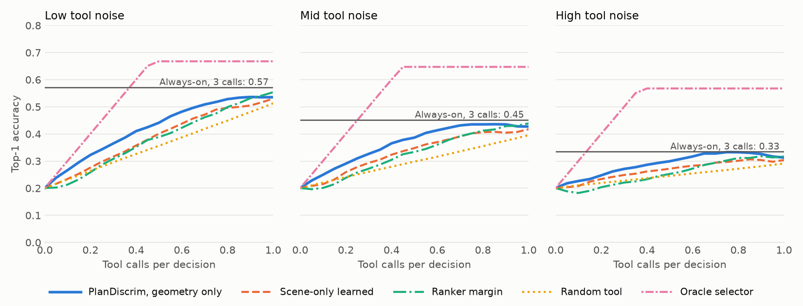

# Phases 3-4: tools, labels and the first baseline

This page reports the first full run of the label pipeline and the selection baselines from
[`refined_proposal.md`](refined_proposal.md). The selector here uses candidate geometry only, because the
VLA pass in Phase 5 has not run. Treat the result as evidence that a selector has room to help, not as the
project result.

## Result

The test split holds 2,288 decisions from 45 seeds that played no part in training. On that split, the geometry
selector beat both rivals at all three noise levels, averaged over budgets from 0 to 1 call per decision. Its
lead is about 2 to 4 percentage points of top-1 accuracy.



| Tool noise | No tool | Always-on (3 calls) | Oracle selector (calls) | PlanDiscrim average | Ranker margin average | Scene-only average | Random average |
|---|---|---|---|---|---|---|---|
| Low | 0.201 | 0.572 | 0.668 (0.47) | 0.421 | 0.381 | 0.385 | 0.357 |
| Mid | 0.201 | 0.452 | 0.647 (0.45) | 0.363 | 0.326 | 0.331 | 0.298 |
| High | 0.201 | 0.335 | 0.568 (0.37) | 0.288 | 0.254 | 0.265 | 0.246 |

The averages run over budgets from 0 to 1 call per decision. Accuracy here means that the top candidate equals
`c*` exactly, which is the proposal's metric.

The table below gives PlanDiscrim's mean accuracy gain over budgets from 0.05 to 1. The intervals are 95%
bootstrap intervals over seeds, and they are not corrected for making six comparisons.

| Tool noise | Over ranker margin | Over scene-only learned |
|---|---|---|
| Low | +0.042 (0.027 to 0.059) | +0.037 (0.027 to 0.049) |
| Mid | +0.039 (0.025 to 0.053) | +0.034 (0.021 to 0.046) |
| High | +0.035 (0.023 to 0.049) | +0.024 (0.014 to 0.034) |

With no tool, the top candidate is unsafe on 0.697 of decisions. At half a call per decision, PlanDiscrim lowers
that rate to 0.437, 0.481 and 0.573 at low, mid and high noise. Ranker margin reaches 0.511, 0.560 and 0.632.

## Against the success criteria

| Criterion | Status | Evidence |
|---|---|---|
| Close to always-on at much lower cost | Partly | One call per decision gives 0.535, 0.427 and 0.313, against 0.572, 0.452 and 0.335 for three calls. Half a call gives 0.441, 0.386 and 0.299, which is not close. |
| Beats generic uncertainty at equal budget | Mostly | It leads ranker margin at every budget up to 0.90, and falls behind by at most 0.018 at 0.95 and 1.00. It leads scene-only learned at every budget. |
| Beats random at equal budget | Yes | It leads at every budget, by 0.012 to 0.097. |
| Abstention better than chance | Yes, with low recall | Precision is 0.753, 0.765 and 0.805, against base rates of 0.533, 0.553 and 0.633. Recall is 0.563, 0.527 and 0.451. |
| Failure modes described | Yes | See the next section. |

## Where it does not help

These numbers use mid noise and half a call per decision.

| Family | Decisions | No tool | Ranker margin | PlanDiscrim | Oracle selector |
|---|---|---|---|---|---|
| `ambiguous_light` | 283 | 0.276 | 0.385 | 0.431 | 0.622 |
| `lane_blockage` | 309 | 0.382 | 0.566 | 0.702 | 0.887 |
| `lead_brake_cutin` | 719 | 0.152 | 0.159 | 0.264 | 0.498 |
| `merge_closing_speed` | 357 | 0.154 | 0.454 | 0.465 | 0.860 |
| `occluded_cross_traffic` | 309 | 0.155 | 0.210 | 0.197 | 0.375 |
| `occluded_pedestrian` | 311 | 0.164 | 0.447 | 0.412 | 0.804 |

PlanDiscrim falls behind ranker margin on `occluded_cross_traffic` and `occluded_pedestrian`. The oracle
selector's column also shows that the selector captures only part of what is available.

Some families have a low ceiling that no selector can raise. With all three tools at zero noise, the ranker
recovers `c*` on 63.6% of decisions overall, but only 34.0% on `occluded_cross_traffic` and 46.3% on
`lead_brake_cutin`. In those families the hazard starts after the decision, so the state at decision time
does not contain it. The other families reach 64.7% to 93.8%.

## What the numbers rest on

These are assumptions, and the results may change with them:

- Noise is Gaussian on range and velocity, plus miss and false-positive rates on ROI and tracking. The three
  levels are in `cassvla/planning/tools.py`, and ROI's noise values were set on seeds 30-49.
- ROI is allowed to report occluded objects, which a real camera crop could not do. This follows the proposal's
  tool table, and it gives ROI much of its value.
- Every tool call costs one unit.
- The generic uncertainty baseline uses the ranker's top-two score margin, with the tool that was best overall
  on the training split. The margin is computed from the candidates, so this rival is not fully
  trajectory-agnostic. Scene-only learned is included as a second rival, and it uses the margin too.
- The dataset holds retained scenes only, and retention uses the oracle. A deployed selector would not get that
  filter, so these accuracies do not describe all driving scenes.
- Reactive re-simulation stays. Hazards respond to the ego's candidate, which the ranker cannot foresee.

Known problems remain:

- Scripted kinematic vehicles move at 0.80 of their commanded speed, while IDM vehicles move at 1.00. Oracle TTC
  uses the commanded velocity and the tools use the measured one, so the two disagree for scripted vehicles. The
  cause is not diagnosed.
- On seeds 20-29, the windows hold less than the 95% target for `merge_closing_speed` (90.6%) and
  `occluded_cross_traffic` (87.3%). The windows were left alone, because the rule forbids changing them after
  validation.
- The ranker uses a disc approximation of each box, so its clearances differ slightly from the oracle's polygon
  clearances.

## Data

| Item | Value |
|---|---|
| Label sweep | Seeds 100-399, 21,719 decisions, 15,041 retained |
| Split by seed | 210 train, 45 validation, 45 test seeds, with no shared seeds |
| Decisions per split | 10,503 train, 2,250 validation, 2,288 test |
| Fewest retained decisions in a family | 1,846 (`ambiguous_light`) |
| Label check | 420 random decisions relabelled in fresh processes: all safety flags and `c*` agree |
| Throughput | 10,007 decisions per hour at 8 processes, 12,238 at 16, at 226 MB per process |

Sweep records and the dataset are under `out/`, which git ignores. To rebuild them:

```bash
OMP_NUM_THREADS=1 .venv/bin/python scripts/run_sweep.py --out out/sweep --start-seed 100 --seeds 300 --chunk 5 --procs 12
.venv/bin/python scripts/build_dataset.py --sweep out/sweep --out out/dataset --procs 6
.venv/bin/python scripts/eval_baselines.py --data out/dataset --split test --out out/eval
.venv/bin/python scripts/plot_pareto.py --eval out/eval/test.json --out docs/baseline_pareto.png
```

## Camera cost for Phase 5

With the camera on, a simulation step took about 1.15 s under Xvfb on this CPU-only machine, because every step
renders. A prefix replay would therefore render every step of the prefix unless the camera stays off until the
decision point. That path has not been tested. Frames arrive in BGR order, so they need flipping before a VLM
sees them.
