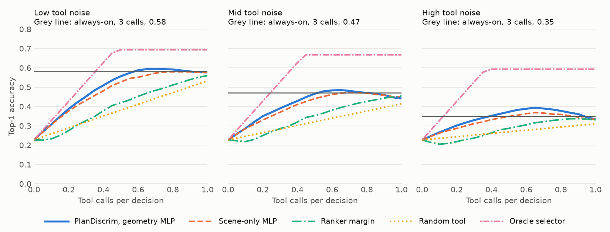

# Phases 3-4: tools, labels and the baseline

This page reports the label pipeline and the selection baselines from
[`refined_proposal.md`](refined_proposal.md). The selector uses candidate geometry only, because the VLA pass
in Phase 5 has not run. Treat the result as evidence about trajectory conditioning under simulated tools, not
as the project result.

These numbers replace the first run from 2026-11-05. That run had scripted vehicles moving at 0.8 of their
commanded speed. After the fix, `c*` changed on 27% of `occluded_cross_traffic` decisions, 7% of
`merge_closing_speed` and 4% of `lead_brake_cutin`, and on none of the other three families.

## Result

The headline numbers come from 2,909 decisions on seeds 400-459. These seeds were labelled after every method
choice was fixed, and the method comparison ran on them once. A later check of whether more training data helps
used them a second time. It was written down before its data existed, and it changed no method choice. A second test split, 2,235 decisions from 45
seeds, gives the same picture.

- The geometry selector is a small MLP. It beats ranker margin by 6 to 10 percentage points of top-1
  accuracy, averaged over budgets from 0 to 1 call per decision.
- Its lead over a scene-only MLP, which sees no candidate geometry beyond the ranker margin, is only 1 to 2
  points. The lead is above zero at every noise level, and in all 40 runs over five training seeds.
- At 0.75 calls per decision, the selector matches or beats always-on, which spends 3 calls.



| Tool noise | No tool | Always-on (3 calls) | Oracle selector (calls) | Selector MLP | Scene-only MLP | Selector logistic | Ranker margin | Random |
|---|---|---|---|---|---|---|---|---|
| Low | 0.227 | 0.583 | 0.693 (0.47) | 0.493 | 0.478 | 0.456 | 0.401 | 0.381 |
| Mid | 0.227 | 0.471 | 0.668 (0.44) | 0.411 | 0.401 | 0.390 | 0.342 | 0.321 |
| High | 0.227 | 0.350 | 0.593 (0.37) | 0.339 | 0.323 | 0.319 | 0.279 | 0.269 |
| Mid, ROI blocked by occluders | 0.227 | 0.477 | 0.670 (0.44) | 0.421 | 0.406 | 0.396 | 0.352 | 0.324 |

The last five columns are averages over budgets from 0 to 1 call per decision. Accuracy means that the top
candidate equals `c*` exactly, which is the proposal's metric.

The next table gives the selector MLP's mean gain over budgets from 0.05 to 1. The intervals are 95% bootstrap
intervals over seeds, and they are not corrected for multiple comparisons.

| Tool noise | Over ranker margin | Over scene-only MLP |
|---|---|---|
| Low | +0.097 (0.086 to 0.108) | +0.016 (0.008 to 0.024) |
| Mid | +0.072 (0.061 to 0.085) | +0.011 (0.002 to 0.021) |
| High | +0.063 (0.050 to 0.077) | +0.017 (0.009 to 0.025) |
| Mid, ROI blocked by occluders | +0.073 (0.057 to 0.088) | +0.016 (0.007 to 0.026) |

Model class matters more than trajectory features here. Moving from logistic regression to the MLP raised the
scene-only rival by about 4 to 6 points, and the selector by about 2 to 4. The features that describe where
the top two candidates part ways changed the logistic selector by less than 0.01 in either direction.

With no tool, the top candidate is unsafe on 0.671 of decisions. At half a call per decision, the selector MLP
lowers that rate to 0.351, 0.442 and 0.519 at low, mid and high noise. Ranker margin reaches 0.488, 0.548 and
0.603. Always-on reaches 0.315, 0.416 and 0.498.

## Against the success criteria

| Criterion | Status | Evidence |
|---|---|---|
| Close to always-on at much lower cost | Yes | At 0.75 calls the selector reaches 0.593, 0.474 and 0.385, against 0.583, 0.471 and 0.350 for three calls. At half a call it reaches 0.557, 0.466 and 0.372. |
| Beats generic uncertainty at equal budget | Yes against ranker margin, narrowly against scene-only | It leads ranker margin at every budget except 0.95 and 1.00 at mid noise and 1.00 with blocked ROI. It leads the scene-only MLP by 1 to 2 points. It falls behind that rival at 0.95 and 1.00 at mid noise, and at 1.00 with high noise or blocked ROI. |
| Beats random at equal budget | Yes | It leads at every budget above 0, by at least 0.016. |
| Abstention better than chance | Yes | The MLP abstains with precision 0.865, 0.864 and 0.865, against base rates of 0.534, 0.560 and 0.634. Recall is 0.764, 0.705 and 0.607. |
| Failure modes described | Yes | See the next section. |

Forcing a call on every decision costs accuracy. Past about 0.7 calls, the curves fall, because a noisy tool
sometimes moves the ranker away from `c*`.

## Where it helps and where it does not

These numbers use the final split, mid noise and half a call per decision.

| Family | Decisions | No tool | Ranker margin | Scene-only MLP | Selector MLP | Oracle selector | Tool the selector uses most |
|---|---|---|---|---|---|---|---|
| `ambiguous_light` | 349 | 0.355 | 0.436 | 0.573 | 0.596 | 0.682 | ROI, 78% |
| `lane_blockage` | 412 | 0.337 | 0.558 | 0.653 | 0.677 | 0.876 | collision, 56% |
| `lead_brake_cutin` | 951 | 0.156 | 0.163 | 0.305 | 0.305 | 0.517 | depth, 61% |
| `merge_closing_speed` | 494 | 0.176 | 0.441 | 0.492 | 0.528 | 0.820 | collision, 59% |
| `occluded_cross_traffic` | 303 | 0.231 | 0.234 | 0.347 | 0.330 | 0.439 | collision, 70% |
| `occluded_pedestrian` | 400 | 0.233 | 0.505 | 0.440 | 0.545 | 0.782 | depth, 57% |

Trajectory conditioning helps most on `occluded_pedestrian`, by 10 points over the scene-only MLP. It gives
nothing on `lead_brake_cutin`, and it falls behind on `occluded_cross_traffic`. The selector picks different
tools for different families, so it has learned which tool matters, not only whether to call one.

Shuffling one feature at a time on the validation split shows what the selector MLP relies on. At mid noise,
the four largest drops in average accuracy come from scene features. These are the distance to the stop line,
the number of visible actors, the nearest visible actor and whether a stop line exists. Shuffling one of them
costs 0.021 to 0.034. About ten trajectory features follow at 0.012 to 0.019 each. They include the candidate
that the ranker puts first, how
much of the candidate paths is occluded, and when the top two candidates part ways.

Two families have a ceiling that no selector can raise. With all three tools at zero noise, the ranker recovers
`c*` on 65.1% of final-split decisions, but only 36.0% on `occluded_cross_traffic` and 43.0% on
`lead_brake_cutin`. In those families the hazard starts after the decision, so the state at decision time does
not contain it. The other families reach 73.1% to 95.1%.

## How much of the oracle's lead is reachable

The oracle selector in the result table sees the tool noise. For each decision, it knows which tool's noise
draw happened to land on `c*`, and no selector can know that. The checks in this section use the validation
and test splits only.

The first check swaps parts of the oracle into the selector MLP. It uses mid noise and half a call per decision
on the validation split, averaged over three training seeds.

| Policy | Accuracy |
|---|---|
| Selector MLP | 0.502 |
| Selector's calls, with a tool that fixes the decision at zero noise | 0.506 |
| Calls and tools chosen where a tool fixes the decision at zero noise | 0.540 |
| Oracle's calls, with the selector's tools | 0.555 |
| Selector's calls, with the tool whose draw lands on `c*` | 0.612 |
| Oracle selector | 0.700 |

Knowing which tool helps when there is no noise adds only 0.004. Most of the oracle's lead comes from choosing
the tool whose draw was lucky.

`scripts/label_expected_gain.py` relabels each decision with eight more noise draws per tool. The mean
correctness over those draws gives two things. The first is a training target with the luck removed. The
second is a fair ceiling. It calls a tool where that tool's expected gain is largest, and never where no tool
has a positive expected gain. The result is scored on the original single draw. The table gives averages over budgets from 0
to 1 call per decision.

| Split | Tool noise | Selector, single-draw targets | Selector, expected-gain targets | Fair ceiling | Oracle selector |
|---|---|---|---|---|---|
| Validation | Low | 0.513 | 0.515 | 0.552 | 0.596 |
| Validation | Mid | 0.445 | 0.450 | 0.493 | 0.594 |
| Validation | High | 0.359 | 0.368 | 0.398 | 0.536 |
| Test | Low | 0.474 | 0.481 | 0.513 | 0.559 |
| Test | Mid | 0.403 | 0.407 | 0.441 | 0.547 |
| Test | High | 0.319 | 0.333 | 0.365 | 0.499 |

The selector sits about 4 points below the fair ceiling at every noise level, and 8 to 18 points below the
oracle selector. The fair ceiling comes from eight draws, and it ignores which features are visible to a
selector. It is a reference point rather than a strict bound.

Expected-gain targets raised the selector in all six cells, by 0.001 to 0.014, and the gain grows with noise.
That met the rule fixed before the run, so the next run trains on expected-gain targets. The result table above
still uses single-draw targets.

## More training data

On the 210 training seeds, a learning curve at mid noise on the validation split suggested that more data
might widen the selector's lead. The scene-only MLP stopped improving at a quarter of the data, while the
selector kept rising.

| Share of the 210 training seeds | Selector MLP | Scene-only MLP | Lead |
|---|---|---|---|
| 10% | 0.420 | 0.414 | +0.007 |
| 25% | 0.429 | 0.427 | +0.002 |
| 50% | 0.439 | 0.429 | +0.011 |
| 100% | 0.449 | 0.428 | +0.021 |

Seeds 460-759 then added 14,707 training decisions, so training grew from 210 to 510 seeds. Across the
validation, test and final splits and four noise settings, the lead grew in 10 of 12 cells. The average lead
moved only from 0.018 to 0.021, and the selector's own accuracy changed by less than 0.01 in every cell. The
amount of data is not what holds the selector back.

Both changes together, 510 seeds with expected-gain targets, raise the selector by 0.003 to 0.014 on the
validation and test splits. Its lead over the scene-only MLP, trained the same way, grows in four of six cells
and stays level at low noise. The selector then sits 3.4 to 3.9 points below the fair ceiling.

| Family, mid noise | No tool | Scene-only MLP | Selector MLP | Fair ceiling |
|---|---|---|---|---|
| `ambiguous_light` | 0.276 | 0.490 | 0.512 | 0.516 |
| `lane_blockage` | 0.382 | 0.603 | 0.671 | 0.682 |
| `lead_brake_cutin` | 0.154 | 0.262 | 0.272 | 0.318 |
| `merge_closing_speed` | 0.149 | 0.404 | 0.436 | 0.482 |
| `occluded_cross_traffic` | 0.181 | 0.272 | 0.297 | 0.325 |
| `occluded_pedestrian` | 0.164 | 0.371 | 0.419 | 0.464 |

These are test-split averages over budgets from 0 to 1 call per decision. On the test split, the selector is
within about one point of the ceiling on `ambiguous_light` and `lane_blockage`. On validation, the gap on
`ambiguous_light` is 3.2 points. Most of
the remaining room is on `lead_brake_cutin`, `merge_closing_speed` and `occluded_pedestrian`, about 4 to 5
points each. A family's ceiling here uses the calls that the overall ceiling makes in that family, so it is not
that family's own best policy.

## Comparison with simple call triggers

This comparison uses `scripts/eval_triggers.py`, and the numbers are in `out/v3_eval/triggers.json`. It trains every
learned selector on 25,036 rows, which are the 10,329 main training rows plus the 14,707 extra rows, with
expected-gain targets. The tables above use 10,329 rows, so the two sets of numbers are not directly comparable. Between
the two training sizes the geometry selector moves by at most 0.005 (see [`phase5_vlm.md`](phase5_vlm.md)). Validation has 2,222
decisions and test has 2,235, and learned selectors are averaged over 3 initialisation seeds. The docstring of `scripts/eval_triggers.py` records
the simple triggers as fixed on 2026-11-07. This comparison is exploratory, because it ran on the validation and test
splits and not on a pre-registered final split.

Budgets here count one call for each decision that gets a call, as a share of all decisions. Always-on costs 3 calls
per decision in the tables above, so the two budget scales differ by a factor of three.

The simple triggers all use the single tool that is best on train. Ranker margin calls the decisions with the smallest
margin first. `ego_speed` calls the fastest scenes first, `candidate_spread` calls the scenes whose candidate endpoints
spread widest, and `fixed_schedule` calls evenly spaced decisions within each episode. The two ablations use the same
MLP as the selector. The scene-only MLP gets the scene features and the ranker margin. The candidate-only MLP gets the
candidate features and the margin.

Mean accuracy over budgets from 0 to 1:

| Policy | Val low | Val mid | Val high | Test low | Test mid | Test high |
|---|---|---|---|---|---|---|
| Random | 0.394 | 0.341 | 0.282 | 0.357 | 0.300 | 0.249 |
| Ranker margin | 0.418 | 0.370 | 0.291 | 0.384 | 0.326 | 0.256 |
| `ego_speed` | 0.399 | 0.348 | 0.285 | 0.381 | 0.321 | 0.264 |
| `candidate_spread` | 0.399 | 0.347 | 0.285 | 0.381 | 0.321 | 0.264 |
| `fixed_schedule` | 0.394 | 0.348 | 0.287 | 0.368 | 0.313 | 0.257 |
| Scene-only MLP | 0.498 | 0.434 | 0.343 | 0.457 | 0.378 | 0.309 |
| Candidate-only MLP | 0.509 | 0.447 | 0.360 | 0.471 | 0.403 | 0.328 |
| Selector MLP | 0.517 | 0.454 | 0.368 | 0.481 | 0.407 | 0.333 |
| Fair ceiling | 0.553 | 0.493 | 0.398 | 0.513 | 0.441 | 0.365 |

- The selector beats every simple trigger in all six cells. The smallest margin is test at high noise, 0.333 against
  0.264 for `ego_speed`. The simple triggers sit only 0 to 0.03 above random, so none of them is a strong rival.
- The selector closes 68% to 75% of the gap between the best simple trigger and the fair ceiling. The scene-only MLP
  closes 45% to 59%.
- Candidate features carry most of the lead over the scene-only MLP. The candidate-only MLP beats it by 0.011 to
  0.026, and adding the scene features back adds 0.004 to 0.009. The spread over the 3 initialisation seeds is 0.001 to
  0.005, and this run has no interval over episodes.
- The accuracy curve peaks near a budget of 0.65, at 0.483 for test at mid noise, and falls to 0.445 at a budget
  of 1.0. Calling every decision is worse than calling about two thirds of them.
- At budget 0.5 on test at mid noise the selector reaches 0.458. Calling the best single tool on every decision reaches 0.441.
- Harmful calls are those whose chosen tool has a negative expected gain. On test, at budgets 0.1 to 0.5, the selector
  makes them on 2.3% to 3.6% of calls at mid noise and 3.7% to 4.9% at high noise. The scene-only MLP makes them on 6.9% to 11.0% and 11.2% to 16.1%.
  Random makes them on about 15% and 18%, and ranker margin on 17% to 37% and 20% to 45%. At a budget of 0.1 on test at mid noise,
  ranker margin captures 3% of the possible benefit, against 20.6% for the selector.
- Per family, the selector trails a simple trigger on `lead_brake_cutin` at low noise on validation and test, and on
  `occluded_cross_traffic` on test at low noise. It trails the scene-only MLP on `ambiguous_light` on test at high noise
  (0.439 against 0.447).
- The KnowNo-style trigger, which calls when the margin falls below a threshold calibrated on train, is degenerate.
  Only the top-two margin is stored, and the threshold it gives calls 99.7% to 100% of decisions. It reduces to calling
  the best single tool every time, so it is not a budgeted rival.

Accuracy is an exact match with the best candidate, and the harm rate counts expected gain, so neither is a collision
rate. The final split of the headline table is not part of this comparison. The second final split (seeds 760-859) has its own section below.

## Pre-registered final test (seeds 760-859)

This is the one run on the second held-out split, `out/v3_final`, with 4,903 decisions. The hypotheses, methods and
settings were written down before any result on these seeds existed, and nothing was changed after. The selectors
train on 34,718 rows, which are the 25,036 rows of the previous section plus the 9,682 retained decisions of seeds
860-1059, with expected-gain targets. Learned selectors are averaged over 3 initialisation seeds. The simple triggers
and the metric are the same as in the previous section. The results are in `out/v3_eval/triggers_final.json` and
`out/v3_eval/final/s4_signed.json`.

What was pre-registered:

- H1: the selector beats ranker margin, at all three noise levels, with a 95% interval above 0.
- H2: the selector beats the scene-only MLP, at all three noise levels, with a 95% interval above 0.
- H3: descriptive only. It reports the smallest budget at which the selector reaches always-on accuracy, and its unsafe
  rate there.
- S1: the selector with the counterfactual flip features beats the selector at all three levels.
- S4: a variant that abstains when its predicted gain is not positive beats the frozen selector at mid and high noise.
  This variant is a linear-output MLP trained with squared error on the signed expected gain. Its method was chosen on
  the validation and test splits before the final test, so S4 is a confirmation on fresh seeds. It was added to the
  plan before any final result existed. Low noise is reported but is not part of S4.

Differences are in mean accuracy over budgets from 0 to 1. The intervals are 95% bootstrap intervals over scenario seeds.

| Hypothesis | Low | Mid | High | Result |
|---|---|---|---|---|
| H1: selector minus ranker margin | +0.093 (0.085 to 0.101) | +0.080 (0.071 to 0.088) | +0.071 (0.062 to 0.079) | Holds |
| H2: selector minus scene-only MLP | +0.020 (0.016 to 0.025) | +0.021 (0.018 to 0.025) | +0.021 (0.017 to 0.025) | Holds |
| S1: flip selector minus selector | 0.000 (-0.002 to 0.002) | +0.003 (0.001 to 0.005) | +0.001 (-0.000 to 0.002) | Does not hold |
| S4: abstain variant minus selector | +0.004 (0.001 to 0.007), reported only | +0.010 (0.006 to 0.014) | +0.018 (0.014 to 0.021) | Holds |

Mean accuracy over budgets from 0 to 1:

| Policy | Low | Mid | High |
|---|---|---|---|
| Random | 0.384 | 0.327 | 0.272 |
| Ranker margin | 0.406 | 0.354 | 0.288 |
| `ego_speed` | 0.390 | 0.339 | 0.289 |
| `candidate_spread` | 0.390 | 0.339 | 0.289 |
| `fixed_schedule` | 0.381 | 0.336 | 0.283 |
| Scene-only MLP | 0.479 | 0.412 | 0.338 |
| Candidate-only MLP | 0.490 | 0.429 | 0.354 |
| Selector MLP | 0.499 | 0.434 | 0.359 |
| Selector with flip features | 0.499 | 0.437 | 0.360 |
| Selector with abstain (S4) | 0.503 | 0.444 | 0.376 |
| Fair ceiling | 0.541 | 0.473 | 0.387 |

H3 compares the selector with always-on, which spends 3 calls per decision. Budgets here count one call per called
decision, as above.

| Tool noise | Always-on accuracy | Selector reaches it at budget | Selector unsafe rate there | Always-on unsafe rate |
|---|---|---|---|---|
| Low | 0.584 | 0.60 | 0.324 | 0.329 |
| Mid | 0.486 | 0.50 | 0.410 | 0.410 |
| High | 0.359 | 0.35 | 0.537 | 0.494 |

At low and mid noise the selector matches always-on on accuracy and on the unsafe rate with 0.5 to 0.6 calls per
decision, which is 17% to 20% of always-on's 3 calls. At high noise it matches the accuracy at a budget of 0.35, but its
unsafe rate there is worse, 0.537 against 0.494. In this descriptive comparison, the criterion of equal safety with fewer calls is therefore met at low
and mid noise and not at high noise. The H3 reading is made on the final curves, so the matching budgets are not
pre-registered values. The unsafe rate is the oracle's label for the chosen candidate, and the run has no
interval on it.

- H1 and H2 hold at all three levels. The lead over the scene-only MLP is about 0.02, the same size as on the
  validation and test splits.
- S1 does not hold: the flip features change the selector by at most 0.003, and only the mid-noise interval is above 0.
- The abstain variant of S4 reaches 0.376 at high noise, about 0.01 below the fair ceiling. Its accuracy curve does not
  fall at high budgets, and it makes fewer harmful calls at a budget of 0.1 (harm rate 0.001 to 0.012 across the three
  levels). The extra gain at low noise is small.
- The choice of S4 used the validation and test splits, so its result here is the first clean estimate. A second
  pre-registered test on fresh seeds (1060 and up) would be needed before treating it as the headline method.

## Second pre-registered final test (seeds 1060-1159)

This is the second and last pre-registered run, on `out/v4_final` with 4,922 decisions from seeds 1060-1159. The
hypotheses, methods and settings were written down before any evaluation on these seeds, and nothing was changed after.
The selectors train on the same 34,718 rows as the first final test, with expected-gain targets and 3 initialisation
seeds. The results are in `out/v4_eval/final_geom.json` (P1 to P4) and `out/v4_eval/final_vlm.json` (Q1).

What was pre-registered:

- P1: the abstain selector (`signed`, linear output, squared error on the signed expected gain, calls only when the
  predicted gain is above 0) beats the frozen selector at mid and high noise. This replicates S4 of the first final test.
- P2: `signed` beats the same model trained on scene features and the ranker margin only (`signed_scene`), at all levels.
- P3: `signed` beats ranker margin at all levels.
- P4: the criterion of equal safety with fewer calls. At a budget of 0.6 calls per decision, which is 20% of always-on's
  3 calls, the accuracy difference from always-on has a lower bound above -0.01, and the unsafe-rate difference has an
  upper bound below +0.01, at all levels.
- Q1: `signed` with the VLM features beats `signed` without them, at all levels.

All intervals are 95% bootstrap intervals over scenario seeds. Differences are in mean accuracy over budgets from 0 to 1.

| Hypothesis | Low | Mid | High | Result |
|---|---|---|---|---|
| P1: `signed` minus frozen | not part of P1 | +0.009 (0.006 to 0.012) | +0.019 (0.016 to 0.023) | Holds |
| P2: `signed` minus `signed_scene` | +0.017 (0.012 to 0.022) | +0.023 (0.019 to 0.027) | +0.026 (0.022 to 0.031) | Holds |
| P3: `signed` minus ranker margin | +0.103 (0.094 to 0.112) | +0.096 (0.088 to 0.105) | +0.091 (0.082 to 0.100) | Holds |
| Q1: `signed` + VLM minus `signed` | +0.016 (0.013 to 0.020) | +0.012 (0.008 to 0.015) | +0.010 (0.007 to 0.013) | Holds |

Mean accuracy over budgets from 0 to 1:

| Policy | Low | Mid | High |
|---|---|---|---|
| Ranker margin | 0.398 | 0.351 | 0.284 |
| `signed_scene` | 0.483 | 0.424 | 0.349 |
| Frozen selector | 0.498 | 0.439 | 0.356 |
| `signed` | 0.500 | 0.447 | 0.375 |
| `signed` + VLM | 0.516 | 0.459 | 0.385 |

P4 compares `signed` at 0.6 calls per decision with always-on, which makes 3 calls.

| Tool noise | Accuracy, `signed` / always-on | Difference (95% interval) | Unsafe rate, `signed` / always-on | Difference (95% interval) |
|---|---|---|---|---|
| Low | 0.592 / 0.585 | +0.006 (-0.002 to 0.016) | 0.302 / 0.315 | -0.013 (-0.021 to -0.005) |
| Mid | 0.521 / 0.490 | +0.031 (0.021 to 0.041) | 0.363 / 0.388 | -0.025 (-0.035 to -0.015) |
| High | 0.422 / 0.357 | +0.066 (0.055 to 0.077) | 0.457 / 0.491 | -0.034 (-0.047 to -0.023) |

With a fifth of always-on's calls, the selector is non-inferior on accuracy at every level and has a lower unsafe rate
at every level. So the criterion of similar or better safety decisions with far fewer calls holds on these seeds. The
unsafe rate is the oracle's label for the chosen candidate. It is not a collision rate.

Caveats:

- The budget of 0.6 was chosen after the first final test, from its curves. These seeds are fresh, but the choice was
  not blind to the earlier split.
- The margin of 0.01 in P4 is ours, not a standard.
- Four primary hypotheses were tested at several levels each, and no correction for multiple comparisons was applied.
  The low-noise accuracy interval in P4 includes 0, so accuracy there is shown to be non-inferior and not better.
- The VLM controls of [`phase5_vlm.md`](phase5_vlm.md) were run on the earlier selector. They were not repeated on
  `signed`.
- All data come from the same scenario generator, and the evaluation is open loop.

## ROI and occlusion

In the default tools, ROI reports objects that an occluder hides, as the proposal's tool table implies. The
variant marked "ROI blocked by occluders" (`mid_los` in `cassvla/planning/tools.py`) uses mid noise, but ROI
there reports only objects in line of sight. The results barely move: always-on changes from 0.471 to 0.477,
and the selector's lead over both rivals stays the same. The occlusion privilege is therefore not what drives
the result, and the more realistic variant is safe to adopt.

Occlusion in the tools is 2D. A rendered frame from `occluded_pedestrian` shows the pedestrian's head above the
parked car's roof, while the tools treat that pedestrian as hidden. Phase 5 frames and the tool models will
disagree on such cases.

## What the numbers rest on

These are assumptions, and the results may change with them:

- Noise is Gaussian on range and velocity, plus miss and false-positive rates on ROI and tracking. The levels
  are in `cassvla/planning/tools.py`, and ROI's noise values were set on seeds 30-49.
- Every tool call costs one unit.
- The ranker-margin baseline uses the ranker's top-two score margin, with the tool that was best overall on
  the training split. The scene-only rivals use the margin too, so they are not fully trajectory-agnostic.
- The MLP has one hidden layer of 32 units and 300 full-batch Adam steps. These settings were fixed before any
  evaluation and not tuned.
- The dataset holds retained scenes only, and retention uses the oracle. A deployed selector would not get that
  filter, so these accuracies do not describe all driving scenes.
- Reactive re-simulation stays. Hazards respond to the ego's candidate, which the ranker cannot foresee.

Known problems remain:

- On validation seeds 50-59, the windows hold less than the 95% target for `occluded_cross_traffic` (87.5%) and
  `ambiguous_light` (93.2%). The windows were left alone, because the rule forbids changing them after
  validation.
- The ranker uses a disc approximation of each box, so its clearances differ slightly from the oracle's polygon
  clearances.

## Data

| Item | Value |
|---|---|
| Main sweep | Seeds 100-399, 21,589 decisions, 14,786 retained |
| Split by seed | 210 train, 45 validation, 45 test seeds, with no shared seeds |
| Decisions per split | 10,329 train, 2,222 validation, 2,235 test |
| Final held-out sweep | Seeds 400-459, 4,287 decisions, 2,909 retained |
| Extra training sweep | Seeds 460-759, 21,676 decisions, 14,707 retained |
| Expected-gain labels | Eight extra noise draws per tool at low, mid and high noise, for the main and extra sweeps |
| Fewest retained decisions in a family | 1,147 in train (`occluded_cross_traffic`) |
| Window tuning and validation | Seeds 0-9 and 50-59 on a 0.5-20 s grid |
| Label check | 420 random decisions relabelled in fresh processes: all `c*`, safety flags and retention agree |
| Second extra training sweep | Seeds 860-1059, 9,682 decisions retained; no dataset or labels built from it yet |
| Second final held-out sweep | Seeds 760-859, 4,903 decisions, used once for the pre-registered test below |
| Third final held-out sweep | Seeds 1060-1159, 4,922 decisions, used once for the second pre-registered test below |
| Throughput | 12,554 decisions per hour at 16 processes |

The table below describes the labels at mid noise, over all 14,786 decisions of the main sweep. A tool is
decision-changing when the ranker is wrong without a tool and right with it. A decision is labelled abstain when
the ranker is already right without a tool, or when no single tool makes it right.

| Family | Decisions | Correct with no tool | ROI changes it | Depth changes it | Collision changes it | Abstain | More than one tool changes it |
|---|---|---|---|---|---|---|---|
| All | 14,786 | 0.225 | 0.213 | 0.298 | 0.274 | 0.550 | 0.252 |
| `ambiguous_light` | 1,846 | 0.339 | 0.285 | 0.124 | 0.102 | 0.639 | 0.105 |
| `lane_blockage` | 2,062 | 0.379 | 0.279 | 0.395 | 0.396 | 0.476 | 0.372 |
| `lead_brake_cutin` | 4,809 | 0.147 | 0.167 | 0.256 | 0.229 | 0.625 | 0.214 |
| `merge_closing_speed` | 2,439 | 0.157 | 0.238 | 0.447 | 0.419 | 0.339 | 0.354 |
| `occluded_cross_traffic` | 1,618 | 0.229 | 0.026 | 0.163 | 0.149 | 0.805 | 0.126 |
| `occluded_pedestrian` | 2,012 | 0.227 | 0.310 | 0.382 | 0.339 | 0.415 | 0.336 |

Sweep records and the datasets are under `out/`, which git ignores. To rebuild them:

```bash
export OMP_NUM_THREADS=1 OPENBLAS_NUM_THREADS=1
.venv/bin/python scripts/run_sweep.py --out out/v2_sweep --start-seed 100 --seeds 300 --procs 16
.venv/bin/python scripts/run_sweep.py --out out/v2_final --start-seed 400 --seeds 60 --procs 16
.venv/bin/python scripts/build_dataset.py --sweep out/v2_sweep --out out/v2_dataset --procs 16
.venv/bin/python scripts/build_dataset.py --sweep out/v2_final --out out/v2_final_ds --procs 16 --as-split final
.venv/bin/python scripts/eval_baselines.py --data out/v2_dataset --test-data out/v2_final_ds --split final --out out/v2_eval
.venv/bin/python scripts/plot_pareto.py --eval out/v2_eval/final.json --out docs/baseline_pareto.png
.venv/bin/python scripts/run_sweep.py --out out/v2_extra --start-seed 460 --seeds 300 --procs 16
.venv/bin/python scripts/build_dataset.py --sweep out/v2_extra --out out/v2_extra_ds --procs 16 --as-split train
.venv/bin/python scripts/label_expected_gain.py --sweep out/v2_sweep --out out/v2_expgain.jsonl --draws 8 --procs 8
.venv/bin/python scripts/label_expected_gain.py --sweep out/v2_extra --out out/v2_extra_expgain.jsonl --draws 8 --procs 16
```

The second pair of sweeps, the counterfactual flip features and the trigger comparison run with:

```bash
.venv/bin/python scripts/run_sweep.py --out out/v3_final --start-seed 760 --seeds 100 --procs 14
.venv/bin/python scripts/run_sweep.py --out out/v3_extra --start-seed 860 --seeds 200 --procs 14
.venv/bin/python scripts/flip_features.py --sweep out/v2_sweep --out out/v3_flip/v2_sweep.jsonl --procs 8
.venv/bin/python scripts/eval_triggers.py --data out/v2_dataset --extra-train out/v2_extra_ds --expgain out/v2_expgain.jsonl out/v2_extra_expgain.jsonl --out out/v3_eval/triggers.json
```

Set the thread variables before evaluating. Without them, numpy's threads compete with each other and the
evaluation runs many times slower.

## Frames for Phase 5

`scripts/hpc/render_frames_hpc.py` renders one 640x360 front-camera frame per decision and checks the ego position
against the label record. It replays each seed once to its last decision, with every graphics output switched
off, and captures each earlier decision on the way. A step then takes 0.002 s instead of 1.13 s, and a frame
takes about 1.2 s under Xvfb on this CPU. In a 12-frame pilot, every frame matched the recorded ego position to
within 5 mm.

```bash
Xvfb :99 -screen 0 1280x720x24 &
DISPLAY=:99 OMP_NUM_THREADS=1 .venv/bin/python scripts/hpc/render_frames_hpc.py --data out/v2_final_ds --split final --out out/v2_frames --procs 1
```

Frames are saved in normal RGB colour order. The camera returns BGR arrays, and the script writes them with
OpenCV, which expects BGR. One worker uses about 4 GB, so this 8 GB machine runs one at a time. A camera env did
not finish building in 10 minutes while 16 sweep processes ran, so render on an idle machine.
