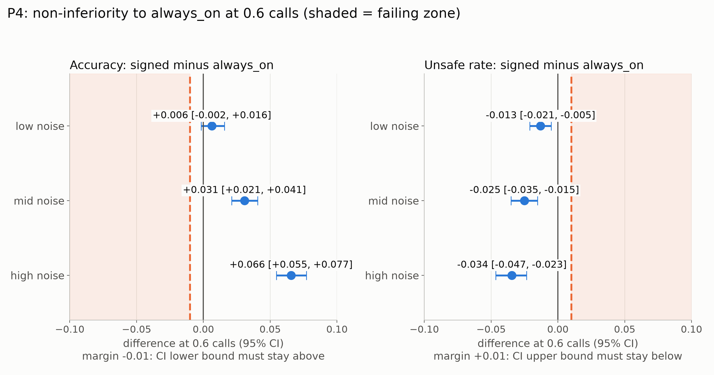
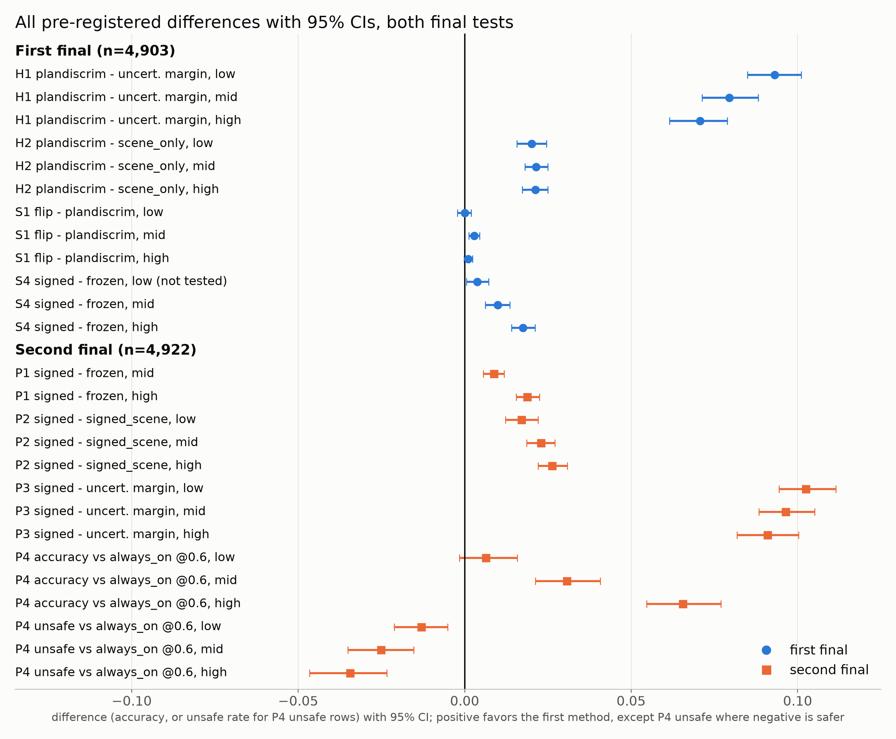
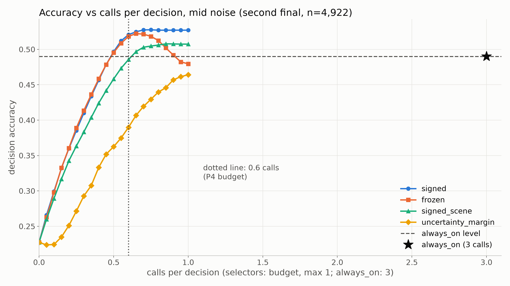
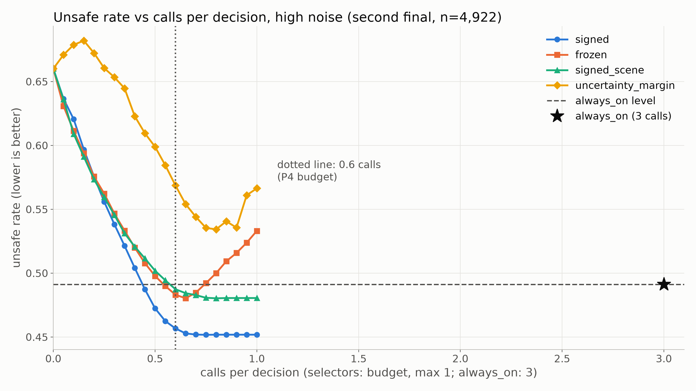
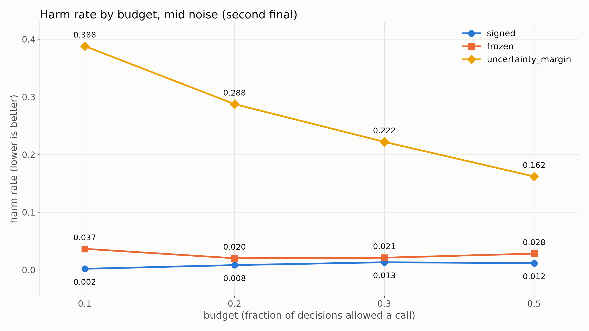
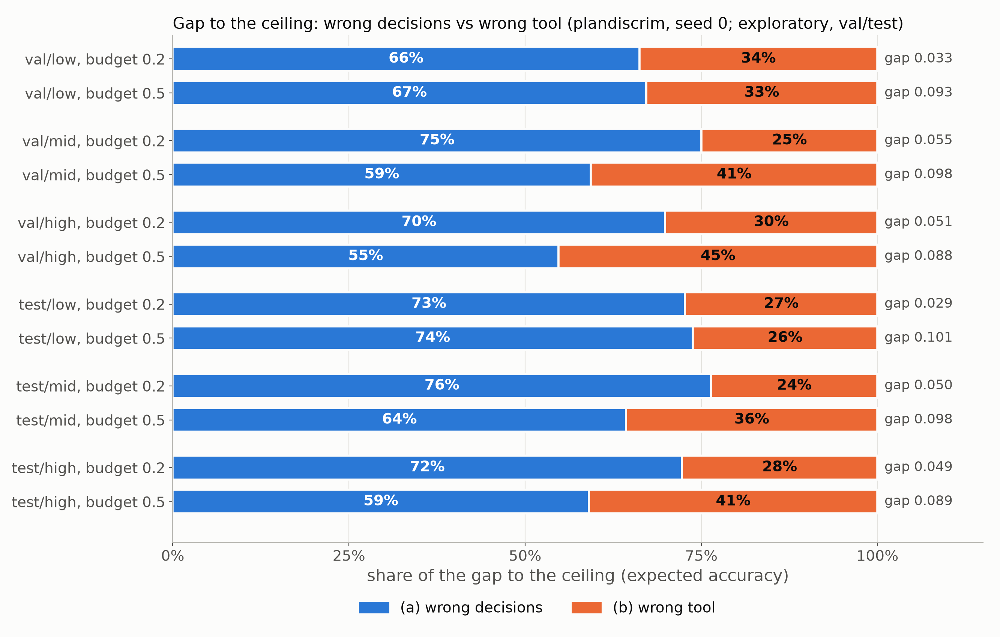
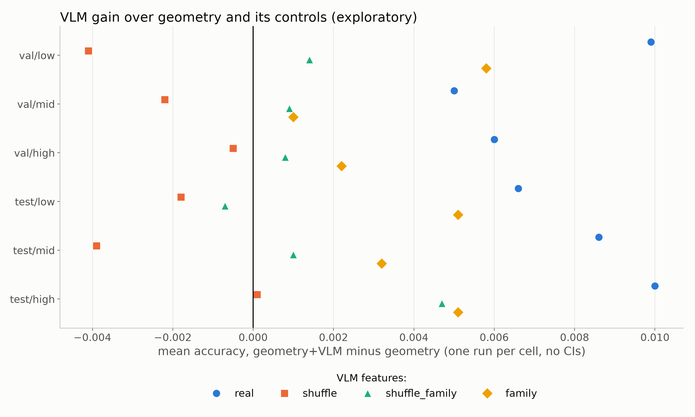
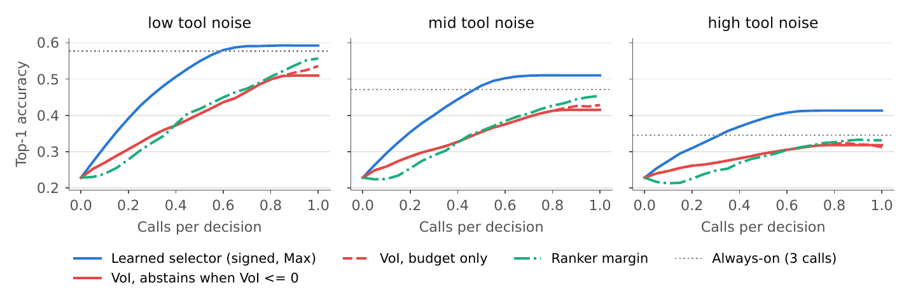

# Which perception tool should a driving planner call? A learned selector and a counterfactual value-of-information selector

*CMPE 249 project, Fall 2026. Max Dokukin and Eshan Chawla. Benchmark and Contribution 1 (learned selector, Sections 1-6): Max Dokukin. Contribution 2 (counterfactual value-of-information selector and on-device VLM study, Section 7): Eshan Chawla. Joint report built from Max's report of 2026-11-20 (`docs/final/build_joint_report.py`).*

## Abstract

A driving planner proposes several candidate trajectories, and a rule-based ranker picks one. Before it picks, a selector may call one perception tool (ROI inspection, depth or a geometric collision check), or none. We ask whether a selector that looks at how the candidates differ can reach the decisions of an always-on policy with far fewer calls, and whether it does better than generic uncertainty triggers. We study this in MetaDrive with six hazard families, simulated tools at three noise levels, and an oracle that labels the best candidate.

The main method is a small MLP that predicts the signed expected gain of each tool and calls only when the best predicted gain is above zero ("signed abstain"). We tested it once, on 100 fresh scenario seeds (4,922 decisions), under a second pre-registration written before any evaluation on those seeds. All four primary hypotheses held. We averaged accuracy over call budgets from 0 to 1. On that measure it beat the earlier frozen MLP by +0.0088 at mid noise and +0.0188 at high noise. It beat the scene-only version of itself by +0.017 to +0.026, and the ranker-margin trigger by +0.091 to +0.103. All 95% intervals are above 0. At a fixed cost of 0.6 calls per decision, which is 20% of always-on's 3 calls, it was non-inferior to always-on on accuracy and safer at every noise level. Its unsafe rate was lower by 0.013, 0.025 and 0.034 at low, mid and high noise, with all intervals below 0. "Unsafe" here is the oracle's label for the chosen candidate. Nothing was run closed loop, so these are decision-quality results, not collision rates.

A second, training-free selector (Contribution 2) estimates each tool's value of information by simulating what it would reveal across hypothetical hidden states and rerunning the ranker. Under its own pre-registration, on a third set of fresh seeds (4,557 decisions), it fell 0.076 to 0.098 below the learned selector and was level with the ranker-margin trigger. The ranker it reasons with agrees with the oracle on only 24% of decisions, which explains most of the gap. A small on-device VLM could read traffic lights but could not choose the tool.

Several limits matter. The 0.6 budget was picked after seeing the first final split. The lead over the scene-only model is small (about 2 points). Adding VLM image features to this selector raised accuracy by +0.010 to +0.016 at all three levels (secondary hypothesis Q1, passed), but we have not yet run the shuffle and family controls on that model. Everything that was not pre-registered is marked exploratory in the text.

## 1 Introduction

**Problem.** A planner often has several plausible trajectories that differ in safety, and the scene alone may not show which one is safe. A hidden pedestrian, a distant light or a misjudged closing speed can each decide the matter. Calling every perception tool on every step is costly in latency and compute. It can also hurt, because a noisy extra reading can pull a correct ranking away from the right answer. Calling nothing leaves the ambiguity in place.

**Scope set by the professor.** The original proposal bundled a candidate planner, a safety critic, several tools, tool selection, conformal calibration, replanning and closed-loop tests. The feedback in `docs/proposal_feedback.md` asked us to keep one question: given a few candidate trajectories and an ambiguous scene, which single extra perception query is most useful for deciding between them? It named three tools (object or ROI inspection, depth or distance, geometric collision check), oracle labels from simulator state, and five comparisons (no tool, random tool, generic uncertainty-based selection, always-on tools and the proposed selector). It also gave the success test: "similar or better safety decisions with substantially fewer perception/VLA calls than generic or always-on verification". Calibration, repeated calls and a supervisor were left for later.

**Contributions.**

1. A reproducible MetaDrive suite with six hazard families, a candidate generator, an oracle and three simulated tools at three noise levels (`docs/scenarios.md`, `docs/oracle.md`).
2. A learned selector that conditions on the candidates. Its candidate features add a small but reliable gain over the same learner without them (+0.017 to +0.026 on fresh seeds).
3. A signed-gain abstain rule. It removes the need to cap the budget: the curve stays flat when no tool is predicted to help, so accuracy no longer falls at high budgets. It also cuts harmful calls.
4. Two pre-registered tests on fresh seeds (first final: seeds 760-859; second final: seeds 1060-1159). The first confirms the method ordering. The second confirms it again and meets a non-inferiority form of the professor's criterion (margin 0.01, budget 0.6 chosen post hoc).
5. Exploratory analyses of where the selector fails, which features matter, what VLM image features add, and which learner variants do not help.

**Contribution 2 (Eshan Chawla).** Items 1 to 5 are Contribution 1 and the benchmark it runs on. Contribution 2 adds: (6) a counterfactual value-of-information selector with no trained model, compared with the learned selector under a third pre-registration on fresh seeds, with ablations and a root-cause diagnosis of why it falls short; and (7) an on-device study of a 4-bit 3B VLM as tool selector and as yes/no detector, including a float16 overflow fix (Section 7).

## 2 Related work

This section is short. It follows the scan in `research/2026-11-06_cass_vla_sota/REPORT.md` (561 papers, 63 rated high). We cite the scan's arXiv ids and did not re-read the papers for this report.

**What is not new.** Deciding to spend compute by its effect on the plan, instead of by scene uncertainty, is now common. SIGMA (2610.09520) calls a cloud VLM when the expected planning gain is high. DEEP (2609.35910) defines the value of extra perception as the signed change in downstream loss and scores allocators against a budget-constrained oracle. BLUE (2606.08684) and ASSCG (2606.25509) gate costly steps on plan value, as do two OpenReview papers, Foresight on Demand and Learning When to Search. DualDriveVLA (2602.10719) gates a VLM call with a scorer that sees the fast path's trajectory. Outside driving, Calibrate-Then-Delegate (2604.14251) trains a probe that predicts the benefit of an expert call. To Call or Not to Call (2605.00737) finds that estimating the utility of a call is harder than estimating the need for one. Best-of-Evidence (2607.20950) keeps a candidate pool fixed and spends a budget on evidence actions, using a plug-in value-of-information estimate and no trained model. Active feature acquisition frames the same step as a greedy choice of the next measurement; our own abstract-level notes on it are in `lit/LIT.md`, and they are not part of the 561-paper scan.

Two findings in this literature affect us directly. Extra evidence often hurts: DEEP reports, in its monocular-geometry settings, that 34% to 54% of escalations that change the loss make it worse, and ToolGate (2606.03054) finds that 9.9% of calls change an answer from right to wrong. Scene features can also be weak predictors: BLUE reports that scene-complexity and kinematic features struggle to predict when language reasoning helps.

**Closest precedents.** The nearest work is an off-road robot paper (2611.06702). It rescores a fixed set of rollouts under resolved map hypotheses and requests the map layer with the largest gain, or none. It is rule-based, has one operating point per policy and has no budget sweep. DriveAgent-R1 (2507.20879) learns a mode token that decides between tool and text reasoning from the front image, speed and command. It never sees the candidate trajectories, and its toolkit has no collision check. Proof-of-Perception (2603.00324) learns a controller over OCR, detector and chart tools with a budget sweep, but it is not a planner.

**What still appears open.** The scan found no paper that chooses among several perception tools for a driving planner from how the planner's candidate trajectories diverge. It also found none that scores that choice as top-1 accuracy against a query budget, next to uncertainty, random and oracle selectors. A patent (US12179756B2) trains an attention model on plan-change labels with and without each actor, which comes close. This is an absence over the papers the scan found, not over the field, and seven OpenReview submissions were read as abstracts only. Our claim is therefore narrow: the combination of candidate-conditioned tool choice, a counterfactual-gain target and a budget curve against an oracle.

**Where Contribution 2 fits.** Best-of-Evidence and the off-road paper (2611.06702) estimate the value of a measurement with a plug-in or rule-based model and no training. Section 7 tests that idea on this benchmark, against the learned selector, on the same budget curve.

## 3 Setup

**Scenarios and hazards.** Six scenario families run on MetaDrive procedural maps with scripted hazards and traffic lights (`docs/scenarios.md`):

- `occluded_pedestrian`: a pedestrian crosses from behind a parked car.
- `occluded_cross_traffic`: a red-light runner at an intersection, hidden by a parked truck.
- `ambiguous_light`: the light changes near the ego's arrival at the stop line.
- `lead_brake_cutin`: a lead vehicle brakes hard, or a neighbour cuts in.
- `lane_blockage`: a stalled car blocks the lane while an overtaker closes in on the next lane.
- `merge_closing_speed`: a slow lead in the ego lane and a fast closer in the next lane.

Hazards react to the ego only through scripted triggers, so the oracle sees non-reactive futures.

**Decision points and data.** A decision point is a family, a seed and a time. The ego first drives a hazard-blind cruise prefix. A decision is kept only if at least one candidate is safe and at least one is unsafe under the oracle, so every kept decision has something to choose. Counts of kept decisions:

| Family | Main dataset (seeds 100-399) | First final (760-859) | Second final (1060-1159) |
|---|---|---|---|
| ambiguous_light | 1846 | 656 | 616 |
| lane_blockage | 2062 | 681 | 691 |
| lead_brake_cutin | 4809 | 1644 | 1657 |
| merge_closing_speed | 2439 | 822 | 812 |
| occluded_cross_traffic | 1618 | 432 | 472 |
| occluded_pedestrian | 2012 | 668 | 674 |
| total | 14786 | 4903 | 4922 |

**Candidates.** Up to six short-horizon maneuvers over a 5 s horizon: keep speed, keep fast, decelerate, stop, and change left or right when that lane exists (`docs/oracle.md`).

**Oracle and labels.** Each candidate is scored by re-simulation against the ground-truth actors. A candidate is safe if it has no collision, red-light or off-road event, a clearance of at least 0.5 m and a time to collision of at least 1.0 s. The oracle order puts safe candidates first and then sorts by a progress-minus-penalty score. The oracle-best candidate `c*` is the first in that order. "Unsafe" in this report means that the oracle marked the ranker's chosen candidate unsafe.

**Ranker.** A rule-based ranker scores candidates from a belief about actors, using the oracle's own safety rules, constant-velocity prediction and a disc approximation of each box (`cassvla/planning/ranker.py`). It sees only what the front camera and the tool responses give it.

**Tools and noise.** The base observation is the front camera with noisy range and velocity, no occluded actors, and the light readable only within 20 m. Three tools add information (`cassvla/planning/tools.py`):

- `roi`: actors in a corridor around the candidates (including occluded ones) and the light state. It can miss an actor or add a phantom.
- `depth`: more accurate range and velocity for actors already in the camera view.
- `collision`: tracked state of every unoccluded actor within 50 m, front or rear, for a per-candidate geometric check.

Tool noise has three levels, which we set by assumption. Low has a depth range error of 2%, a velocity error of 0.2 m/s and a miss rate of 2%. Mid has 5%, 0.5 m/s and 10%. High has 10%, 1.0 m/s and 25%. Each call costs one.

**Accuracy and budget.** Accuracy is the share of decisions where the ranker's top candidate equals `c*` after the optional tool call. A budget b is the share of decisions that receive one call, so it costs b calls per decision. Always-on calls all three tools on every decision, which costs 3 calls per decision. So a budget of 0.6 is 20% of always-on's calls. Every headline number is accuracy averaged over 21 budgets from 0 to 1 in steps of 0.05, unless the text says "at budget".

**Expected-gain targets.** A single noise draw decides whether a noisy tool happens to fix a decision, which no selector can foresee. For each decision, level and tool we therefore average correctness over 8 noise draws (`scripts/label_expected_gain.py`). The expected gain of a tool is that mean minus the no-tool correctness. A call is "harmful" when the chosen tool has a negative expected gain. "Benefit captured" is the expected gain of the calls made, divided by the best expected gain summed over every decision.

**Reference points.** The fair ceiling calls the tool with the largest expected gain and cannot see the noise draws. It is a reference, not a method.

## 4 Methods

**Features.** The selector sees 39 features (`cassvla/planning/features.py`). Eleven are scene features: ego speed, visible-actor counts, nearest visible actor, light state, stop-line distance and the ranker margin. The other 28 describe the candidate set. They include the top candidate's clearance and time to collision, how far the candidate endpoints and progress spread, how much of the top path is occluded, which maneuver the top candidate is, and a divergence group. The divergence group says where and when the top two candidates part ways (`div_time`, `div_occl`, `div_actor_near`, `div_lateral`, `div_progress`) and how safe the runner-up is. "Scene-only" means the 11 scene features, which include the margin. "Candidate-only" means the candidate features plus the margin.

**Frozen learned selector.** A one-hidden-layer MLP (32 ReLU units) with one sigmoid output per tool and a class-balanced loss on the gain clipped to [0, 1]. It trains for 300 full-batch Adam steps with learning rate 0.01 and L2 1e-3, and we average three init seeds (0, 1 and 2). The code is `fit_mlp` in `scripts/eval_baselines.py`. These settings were fixed before the first evaluation and never changed. We call this model `plandiscrim` in the first final and `frozen` in the second. To meet a budget, it ranks decisions by its highest predicted score, calls the top share and uses the argmax tool.

**Signed-gain abstain (`signed`).** The same MLP with a linear output, trained with squared error on the unclipped expected gain (a gain can be negative). It calls only when the largest predicted gain is above 0 and the decision lies within the budget, and it picks the argmax tool. So it can leave part of the budget unused, and its curve stops rising when no tool is predicted to help. The method came out of an exploratory comparison of nine learner variants on validation and test seeds (section 6.4). It was then pre-registered as S4 in the first final and as the primary method in the second.

**Baselines.**

- `uncertainty_margin`: calls the lowest-margin decisions first, with the tool that is best on the training set. This is the generic uncertainty trigger.
- Other simple triggers (first final only): `ego_speed`, `candidate_spread`, `fixed_schedule` and `random` (20 runs). The trigger `knowno` calls below a margin threshold calibrated on train. It called 99.76% to 100% of decisions, so it is degenerate and not a budgeted trigger.
- `scene_only` and `candidate_only`: the same learner on subsets of the features. `signed_scene` is the signed model on scene features only.
- `always_on`: all three tools on every decision (3 calls).
- `plandiscrim_flip` (first final, secondary): all features plus counterfactual "flip" features that rerun the ranker with each tool's response (`scripts/flip_features.py`).

## 5 Evaluation protocol

**Seed splits.** All splits are by scenario seed, never by frame, so that near-identical consecutive frames cannot leak between train and test. The table is from `.agents/skills/doc/references/SEEDS.md`.

| Seeds | Used for |
|---|---|
| 0-9 | choosing decision windows (`t_window`), twice |
| 10-29 | old window validation, before the speed fix |
| 30-49 | setting ROI noise and the tie rule in `labels.py` |
| 50-59 | window validation after the speed fix |
| 100-399 | main dataset, split 70/15/15 by seed (train, validation, test) |
| 400-459 | earlier final test, seen and not reusable |
| 460-759 | extra training seeds (first extra set) |
| 760-859 | first final test (pre-registered, used once on 2026-11-19, now seen) |
| 860-1059 | extra training seeds (second extra set) |
| 1060-1159 | second final test (pre-registered, used once on 2026-11-20, now seen) |
| 1160 and up | free for new work |

**Two pre-registrations.** `PREREG.md` was written on 2026-11-19 at 18:03, before the first final split was finished or labelled. It fixed the first final test on seeds 760-859:

- H1: `plandiscrim` beats `uncertainty_margin`.
- H2: `plandiscrim` beats `scene_only`.
- H3: a descriptive report of the budget at which `plandiscrim` matches always-on.

Two amendments were written before any output existed. The first says `knowno` is reported as degenerate above a 95% call rate. The second adds S4, which says that signed abstain beats `plandiscrim` at mid and high noise.

`run2/PREREG2.md` was written on 2026-11-20 at 01:50, before any evaluation on seeds 1060-1159. It fixed the second final with P1 to P4, a secondary Q1 and a descriptive Q2. The text of each hypothesis is in section 6. After a final run, no method, feature, setting, training set or budget was allowed to change. Later analyses are labelled post hoc or exploratory.

**Confidence intervals.** All intervals are 95% paired bootstrap intervals over scenario seeds, with 1,000 resamples. The resampling unit is the seed, so all decisions from one scenario seed move together. The intervals do not cover variation from init seeds, the training set or the choice of method. The learned selectors average three init seeds before the bootstrap.

**Multiple comparisons.** The second final has four primary hypotheses. Counting each noise level they name, that is 11 level-tests (P1 two, P2 three, P3 three, P4 three) and 14 intervals, because each P4 level has an accuracy interval and an unsafe-rate interval. No correction was applied. The three noise levels reuse the same decisions, so they are not independent evidence. Read a narrow pass with that in mind, such as P4 accuracy at low noise (lower bound -0.0016 against a margin of -0.01). The exploratory sections tried about a dozen variants on the same validation and test rows, so they carry a stronger caveat.

## 6 Results

### 6.1 First final (pre-registered): seeds 760-859, 4,903 decisions

Training data were the train splits of the main dataset, the first extra set (seeds 460-759) and the second extra set (seeds 860-1059): 34,718 rows. The sources are `out/v3_eval/triggers_final.json` and `out/v3_eval/final/s4_signed.json`. Each cell is a difference in mean accuracy over budgets, with the 95% interval in brackets.

| Hypothesis | Low | Mid | High |
|---|---|---|---|
| H1: plandiscrim minus uncertainty_margin | +0.0931 [0.0849, 0.1011] | +0.0795 [0.0713, 0.0882] | +0.0707 [0.0615, 0.0789] |
| H2: plandiscrim minus scene_only | +0.0201 [0.0157, 0.0246] | +0.0214 [0.0181, 0.0250] | +0.0212 [0.0173, 0.0250] |
| S1: plandiscrim_flip minus plandiscrim | +0.0000 [-0.0022, 0.0020] | +0.0029 [0.0013, 0.0045] | +0.0011 [-0.0002, 0.0024] |
| S4: signed_mse_abstain minus plandiscrim | +0.0038 [0.0006, 0.0072] | +0.0099 [0.0062, 0.0136] | +0.0175 [0.0141, 0.0211] |

H1 and H2 held at all three levels. S1 failed: the flip features helped at mid noise only (+0.0029) and not at low or high noise. S4 held at mid and high noise. Low noise was reported but is not part of S4.

Mean accuracy over budgets for every policy:

| Policy | Low | Mid | High |
|---|---|---|---|
| random | 0.3835 | 0.3265 | 0.2719 |
| uncertainty_margin | 0.4058 | 0.3543 | 0.2881 |
| ego_speed | 0.3902 | 0.3390 | 0.2893 |
| candidate_spread | 0.3903 | 0.3390 | 0.2895 |
| fixed_schedule | 0.3812 | 0.3358 | 0.2834 |
| scene_only | 0.4788 | 0.4123 | 0.3376 |
| candidate_only | 0.4901 | 0.4287 | 0.3541 |
| plandiscrim | 0.4990 | 0.4338 | 0.3588 |
| plandiscrim_flip | 0.4990 | 0.4367 | 0.3599 |
| signed_mse_abstain (S4) | 0.5028 | 0.4437 | 0.3763 |
| fair_ceiling | 0.5413 | 0.4726 | 0.3867 |

The simple triggers sit between 0.002 below and 0.03 above random. The ranker-margin trigger never reached always-on accuracy at any budget up to 1.0, at any level.

**Calls needed to match always-on (H3, descriptive).** The table shows where `plandiscrim` first reaches always-on's accuracy and its unsafe rate there. The last column is a post hoc reading of the same curves and was not part of `PREREG.md`.

| Noise | Always-on acc / unsafe | plandiscrim first matches accuracy at | its acc / unsafe there | unsafe minus always-on there | First budget matching both (post hoc) |
|---|---|---|---|---|---|
| low | 0.5841 / 0.3286 | 0.60 | 0.5937 / 0.3237 | -0.0049 | 0.60 |
| mid | 0.4860 / 0.4104 | 0.50 | 0.4900 / 0.4103 | -0.0001 | 0.50 |
| high | 0.3586 / 0.4936 | 0.35 | 0.3618 / 0.5367 | +0.0431 | 0.60 |

At low and mid noise, `plandiscrim` matched always-on's unsafe rate as soon as it matched accuracy. At high noise it matched accuracy at 0.35 calls per decision but was 0.0431 less safe there. It needed 0.60 calls to match both (post hoc). This is the one place where fewer calls traded away safety. A separate post hoc analysis of the signed model (`H3_POSTHOC.md`) found it safer than always-on at 0.6 calls per decision at all three levels, which is why 0.6 was fixed for the second pre-registration.

**S2 (secondary): harm and benefit.** Each cell is harm rate / benefit captured.

| Noise | Policy | 0.1 | 0.2 | 0.3 | 0.5 |
|---|---|---|---|---|---|
| low | plandiscrim | 0.009 / 0.203 | 0.007 / 0.389 | 0.018 / 0.533 | 0.025 / 0.781 |
| low | scene_only | 0.040 / 0.181 | 0.048 / 0.334 | 0.048 / 0.473 | 0.054 / 0.701 |
| low | uncertainty_margin | 0.163 / 0.037 | 0.113 / 0.137 | 0.096 / 0.265 | 0.079 / 0.478 |
| mid | plandiscrim | 0.046 / 0.181 | 0.029 / 0.351 | 0.028 / 0.494 | 0.035 / 0.727 |
| mid | scene_only | 0.065 / 0.166 | 0.082 / 0.310 | 0.092 / 0.433 | 0.095 / 0.645 |
| mid | uncertainty_margin | 0.416 / 0.030 | 0.273 / 0.125 | 0.222 / 0.246 | 0.166 / 0.453 |
| high | plandiscrim | 0.115 / 0.180 | 0.073 / 0.329 | 0.058 / 0.454 | 0.066 / 0.655 |
| high | scene_only | 0.134 / 0.158 | 0.156 / 0.283 | 0.156 / 0.381 | 0.143 / 0.573 |
| high | uncertainty_margin | 0.473 / 0.031 | 0.323 / 0.118 | 0.263 / 0.226 | 0.195 / 0.420 |

At budget 0.1 and mid noise the margin trigger spent 41.6% of its calls on tools that hurt and captured 3.0% of the available benefit. `plandiscrim` spent 4.6% and captured 18.1%.

**S4 in detail.**

| Measure | Low | Mid | High |
|---|---|---|---|
| mean accuracy, signed / frozen | 0.5028 / 0.4990 | 0.4437 / 0.4338 | 0.3763 / 0.3588 |
| accuracy at budget 1.0, signed / frozen | 0.6024 / 0.5763 | 0.5205 / 0.4726 | 0.4293 / 0.3613 |
| always-on accuracy | 0.5841 | 0.4860 | 0.3586 |
| tool-optimal rate, signed | 0.432 | 0.510 | 0.491 |

On fresh seeds the signed model's curve no longer fell after budget 0.65, and at budget 1.0 it was above always-on's accuracy at all three levels. Its tool-optimal rate was lower than the frozen model's, so the gain is not from better tool choice. It is consistent with a better choice of where to call. On validation and test, the exploratory comparison attributed roughly a third to a half of the gain to the regression target and the rest to the abstain rule (`experiments/EXPERIMENTS.md`).

**S3 (secondary): per-family accuracy,** shown as `plandiscrim` / `scene_only` / `uncertainty_margin`. These are point estimates without intervals.

| Family | Low | Mid | High |
|---|---|---|---|
| ambiguous_light | 0.604 / 0.587 / 0.450 | 0.581 / 0.559 / 0.429 | 0.533 / 0.512 / 0.401 |
| lane_blockage | 0.726 / 0.668 / 0.607 | 0.695 / 0.639 / 0.563 | 0.590 / 0.538 / 0.476 |
| lead_brake_cutin | 0.300 / 0.301 / 0.267 | 0.271 / 0.268 / 0.217 | 0.232 / 0.227 / 0.184 |
| merge_closing_speed | 0.686 / 0.666 / 0.491 | 0.458 / 0.443 / 0.386 | 0.297 / 0.278 / 0.256 |
| occluded_cross_traffic | 0.330 / 0.317 / 0.274 | 0.325 / 0.316 / 0.264 | 0.271 / 0.265 / 0.217 |
| occluded_pedestrian | 0.533 / 0.493 / 0.479 | 0.465 / 0.417 / 0.423 | 0.396 / 0.355 / 0.329 |

### 6.2 Second final (pre-registered): seeds 1060-1159, 4,922 decisions

The results are in `out/v4_eval/final_geom.json`, written by `run2/experiments/final.py`. The training set was the same 34,718 rows as in the first final, as `PREREG2.md` fixed. All numbers in this section are pre-registered unless marked post hoc.

| Method | Acc low | Acc mid | Acc high | Unsafe low | Unsafe mid | Unsafe high |
|---|---|---|---|---|---|---|
| signed | 0.5001 | 0.4473 | 0.3752 | 0.3966 | 0.4429 | 0.5097 |
| frozen | 0.4984 | 0.4386 | 0.3563 | 0.4029 | 0.4569 | 0.5358 |
| signed_scene | 0.4830 | 0.4243 | 0.3489 | 0.4092 | 0.4600 | 0.5272 |
| uncertainty_margin | 0.3975 | 0.3509 | 0.2842 | 0.4945 | 0.5369 | 0.6037 |
| always_on (3 calls) | 0.5853 | 0.4900 | 0.3566 | 0.3145 | 0.3881 | 0.4911 |

P1 to P3 compare mean accuracy over budgets, and each cell is a difference with its 95% interval.

| Hypothesis (pre-registered) | Low | Mid | High | Verdict |
|---|---|---|---|---|
| P1: signed minus frozen | not part of the hypothesis | +0.0088 [0.0056, 0.0119] | +0.0188 [0.0155, 0.0225] | pass |
| P2: signed minus signed_scene | +0.0171 [0.0123, 0.0221] | +0.0230 [0.0186, 0.0271] | +0.0263 [0.0220, 0.0308] | pass |
| P3: signed minus uncertainty_margin | +0.1025 [0.0944, 0.1115] | +0.0964 [0.0884, 0.1051] | +0.0910 [0.0818, 0.1003] | pass |

P4 is the professor's criterion at a fixed cost of 0.6 calls per decision. Non-inferiority needs the accuracy difference to have a lower bound above -0.01 and the unsafe-rate difference to have an upper bound below +0.01, at every level.

| Noise | Accuracy, signed minus always-on | Lower bound above -0.01 | Unsafe rate, signed minus always-on | Upper bound below +0.01 |
|---|---|---|---|---|
| low | +0.0064 [-0.0016, 0.0158] | yes | -0.0130 [-0.0211, -0.0051] | yes |
| mid | +0.0307 [0.0212, 0.0407] | yes | -0.0251 [-0.0351, -0.0153] | yes |
| high | +0.0656 [0.0547, 0.0770] | yes | -0.0344 [-0.0466, -0.0234] | yes |

All four primary hypotheses passed. Two cautions apply to P4. The 0.6 budget was chosen post hoc from the first final split (`run2/analysis4/H3_POSTHOC.md`), even though these seeds are fresh. The margin of 0.01 is also our choice. At low noise the accuracy difference is +0.0064 with an interval that includes 0, so the claim there is "no worse", not "better". At mid and high noise accuracy is higher by +0.0307 and +0.0656, with intervals above 0. The unsafe rate is lower at every level.

Accuracy and unsafe rate at 0.6 calls per decision for each method:

| Method at 0.6 calls per decision | Low (acc / unsafe) | Mid (acc / unsafe) | High (acc / unsafe) |
|---|---|---|---|
| signed | 0.5918 / 0.3015 | 0.5208 / 0.3630 | 0.4222 / 0.4567 |
| frozen | 0.5937 / 0.3073 | 0.5183 / 0.3760 | 0.4065 / 0.4831 |
| signed_scene | 0.5617 / 0.3299 | 0.4856 / 0.3927 | 0.3834 / 0.4874 |
| uncertainty_margin | 0.4468 / 0.4356 | 0.3899 / 0.4870 | 0.3102 / 0.5687 |
| always_on (3 calls) | 0.5853 / 0.3145 | 0.4900 / 0.3881 | 0.3566 / 0.4911 |



*P4 at 0.6 calls per decision: difference from always-on in accuracy and unsafe rate, with 95% intervals.*

**Q1 (secondary, pre-registered): signed with VLM image features.** `signed_vlm` adds 32 PCA components of the middle-layer image embedding to the 39 geometry features, which gives 71 inputs. The PCA is fitted on the training rows only. The embeddings for the second extra set and the second final set came from a cluster GPU job (job 159857, one A100, 32 minutes, `run2/hpc_status.md`). The harness runs only if every train and test row has an embedding, and all 34,718 training rows and 4,922 test rows did. Q1 passed at all three levels. The results are in `out/v4_eval/final_vlm.json`.

| Measure | Low | Mid | High |
|---|---|---|---|
| Q1: signed_vlm minus signed (mean accuracy over budgets) | +0.0163 [0.0129, 0.0196] | +0.0115 [0.0084, 0.0149] | +0.0099 [0.0073, 0.0125] |
| signed_vlm mean accuracy / mean unsafe | 0.5163 / 0.3842 | 0.4589 / 0.4354 | 0.3851 / 0.5040 |
| signed mean accuracy / mean unsafe (same run) | 0.5001 / 0.3966 | 0.4473 / 0.4429 | 0.3752 / 0.5097 |
| at 0.6 calls, signed_vlm acc / unsafe | 0.6082 / 0.2897 | 0.5326 / 0.3589 | 0.4338 / 0.4536 |

The gain of +0.010 to +0.016 is of the size seen on validation and test (+0.008 to +0.015, section 6.4). One caution applies. We have not run the shuffle and family controls on the signed model, so extra capacity from 32 more inputs (71 against 39) is not ruled out as part of the gain.

**Q2 (descriptive): harm, benefit, curve shape and families.** Each cell is harm rate / benefit captured.

| Noise | Method | 0.1 | 0.2 | 0.3 | 0.5 |
|---|---|---|---|---|---|
| low | signed | 0.000 / 0.198 | 0.002 / 0.382 | 0.003 / 0.527 | 0.010 / 0.775 |
| low | frozen | 0.005 / 0.205 | 0.006 / 0.388 | 0.014 / 0.542 | 0.020 / 0.788 |
| low | signed_scene | 0.040 / 0.177 | 0.041 / 0.341 | 0.042 / 0.473 | 0.047 / 0.707 |
| low | uncertainty_margin | 0.144 / 0.033 | 0.117 / 0.123 | 0.097 / 0.247 | 0.074 / 0.468 |
| mid | signed | 0.002 / 0.195 | 0.008 / 0.359 | 0.013 / 0.497 | 0.012 / 0.730 |
| mid | frozen | 0.037 / 0.192 | 0.020 / 0.366 | 0.021 / 0.509 | 0.028 / 0.741 |
| mid | signed_scene | 0.053 / 0.175 | 0.063 / 0.322 | 0.071 / 0.445 | 0.077 / 0.665 |
| mid | uncertainty_margin | 0.388 / 0.029 | 0.288 / 0.115 | 0.222 / 0.233 | 0.162 / 0.447 |
| high | signed | 0.002 / 0.184 | 0.029 / 0.333 | 0.020 / 0.462 | 0.015 / 0.660 |
| high | frozen | 0.083 / 0.188 | 0.056 / 0.340 | 0.048 / 0.461 | 0.054 / 0.664 |
| high | signed_scene | 0.079 / 0.177 | 0.071 / 0.300 | 0.068 / 0.408 | 0.074 / 0.593 |
| high | uncertainty_margin | 0.478 / 0.029 | 0.348 / 0.109 | 0.268 / 0.217 | 0.193 / 0.411 |

Curve shape and tool choice:

| Measure | Low | Mid | High |
|---|---|---|---|
| signed: accuracy at budget 1.0 | 0.6025 | 0.5271 | 0.4272 |
| signed: drop after the peak | 0.0006 | 0.0006 | 0.0001 |
| signed: tool-optimal rate | 0.421 | 0.533 | 0.495 |
| signed: share roi / depth / collision (mid) |  | 0.131 / 0.658 / 0.211 |  |
| frozen: accuracy at budget 1.0 | 0.5753 | 0.4796 | 0.3528 |
| frozen: drop after the peak | 0.0266 | 0.0427 | 0.0582 |
| frozen: tool-optimal rate | 0.507 | 0.576 | 0.528 |
| frozen: share roi / depth / collision (mid) |  | 0.262 / 0.664 / 0.075 |  |

The frozen model's accuracy falls after its peak by 0.0266, 0.0427 and 0.0582 at low, mid and high noise. The signed model's drop is at most 0.0006. The signed model's tool-optimal rate is again lower than the frozen model's, so its gain is not from better tool choice. It is consistent with a better choice of where to call, and on validation and test part of it comes from the regression target (see section 6.1).

Per-family accuracy, shown as `signed` / `signed_scene` / `uncertainty_margin` (point estimates, no intervals):

| Family | Low | Mid | High |
|---|---|---|---|
| ambiguous_light | 0.602 / 0.615 / 0.438 | 0.592 / 0.603 / 0.426 | 0.547 / 0.560 / 0.400 |
| lane_blockage | 0.715 / 0.642 / 0.582 | 0.708 / 0.623 / 0.552 | 0.618 / 0.529 / 0.474 |
| lead_brake_cutin | 0.303 / 0.301 / 0.254 | 0.275 / 0.269 / 0.212 | 0.228 / 0.228 / 0.162 |
| merge_closing_speed | 0.697 / 0.697 / 0.499 | 0.502 / 0.496 / 0.406 | 0.345 / 0.315 / 0.274 |
| occluded_cross_traffic | 0.341 / 0.320 / 0.271 | 0.332 / 0.307 / 0.247 | 0.304 / 0.273 / 0.233 |
| occluded_pedestrian | 0.546 / 0.502 / 0.491 | 0.488 / 0.435 / 0.422 | 0.417 / 0.364 / 0.334 |

The signed model is above `signed_scene` in most cells. The largest gaps are in `lane_blockage` (+0.073 to +0.089) and `occluded_pedestrian` (+0.044 to +0.053). The scene-only model is ahead on `ambiguous_light` (by 0.013, 0.011 and 0.013), so candidate features do not help everywhere. We did not compute family-level intervals.



*All pre-registered differences with 95% intervals, both finals. The P4 unsafe rows are unsafe-rate differences, where negative is safer.*

### 6.3 Calls needed against always-on

Always-on makes 3 calls per decision. The table gives the first budget on the 0.05 grid at which each curve reaches always-on's accuracy, then its unsafe rate, then both on the same budget. It is a post hoc reading of the second final curves, not a pre-registered test, so read it next to P4.

| Method | Low (acc / unsafe / both) | Mid (acc / unsafe / both) | High (acc / unsafe / both) |
|---|---|---|---|
| signed | 0.60 / 0.55 / 0.60 | 0.50 / 0.50 / 0.50 | 0.35 / 0.45 / 0.45 |
| frozen | 0.60 / 0.60 / 0.60 | 0.50 / 0.55 / 0.55 | 0.35 / 0.55 / 0.55 |
| signed_scene | 0.75 / 0.70 / 0.75 | 0.65 / 0.65 / 0.65 | 0.45 / 0.60 / 0.60 |
| uncertainty_margin | not reached / not reached / not reached | not reached / not reached / not reached | not reached / not reached / not reached |

The signed model matches always-on's accuracy at 0.60, 0.50 and 0.35 calls per decision at low, mid and high noise. It matches accuracy and unsafe rate together at 0.60, 0.50 and 0.45, which is 15% to 20% of always-on's calls. The frozen model needs 0.60, 0.55 and 0.55 for both, and the scene-only signed model needs 0.75, 0.65 and 0.60. The ranker-margin trigger never reaches either measure. It uses one fixed tool, so its call rate is capped at one call per decision, and its accuracy at budget 1.0 (0.558, 0.464 and 0.339) stays below always-on's.

On the first final split, the post hoc analysis in `run2/analysis4/H3_POSTHOC.md` finds the same pattern on a 0.01 grid. The frozen model first matched always-on accuracy at 0.57, 0.49 and 0.35 calls per decision (bootstrap 95% intervals [0.53, 0.59], [0.46, 0.53] and [0.30, 0.40]). The matching budget is a soft quantity. In the cases we checked, the 0.05 grid rounded it up by at most 0.03 (a 0.05 grid can round up by as much as 0.05), and the unsafe-rate curve dips below always-on's and later rises back above it near budget 1.



*Accuracy against calls per decision at mid noise, second final. Always-on sits at 3 calls.*



*Unsafe rate against calls per decision at high noise, second final. Always-on sits at 3 calls.*

### 6.4 Exploratory analyses (not pre-registered)

Unless stated otherwise, these analyses ran on the validation and test splits of the main dataset (2,222 and 2,235 decisions) with up to 25,036 training rows. We chose and read them after the numbers were visible, and the intervals do not cover the choice of analysis. The sources are `analysis/RESULTS.md`, `analysis2/FAILURES.md`, `analysis3/SAFETY.md`, `experiments/EXPERIMENTS.md` and `run2/experiments/EXPERIMENTS2.md`.

**Harm.** On the test split at budgets 0.1 to 0.5, the frozen model's calls were harmful on 2.3% to 3.6% of calls at mid noise and 3.7% to 4.9% at high noise. The ranker-margin trigger's were harmful on 17% to 37% (mid) and 20% to 45% (high). The signed model cut the harm rate at budget 0.1 on test at mid noise from 0.036 to 0.003. On the second final its harm rate at mid noise was at most 0.0117 over budgets 0.1 to 0.5 (section 6.2).



*Harm rate at budgets 0.1, 0.2, 0.3 and 0.5 at mid noise, second final.*

**Failure modes of the frozen model.**

- Late calls hurt. Its curve peaks near budget 0.65 and then falls (for example from 0.483 to 0.445 at test and mid noise). Calls ranked past 65% are harmful 26% to 46% of the time, while only 4% to 10% of the total best-tool gain lies there. Even the best tool has a mean expected gain between -0.07 and +0.01 on those decisions. So this is mostly not a tool-choice error: those decisions do not benefit from a call.
- Wrong decision against wrong tool. 55% to 76% of the gap to the fair ceiling comes from calling on the wrong decisions, and the rest from choosing the wrong tool.
- Depth collapse. At mid noise the frozen model predicted depth on 1,514 of 2,222 validation decisions. It predicted collision on 130, although collision was the best tool on 272.
- Weak families. `lead_brake_cutin` is the largest family and has the lowest ceiling, and there the learned selector is close to a simple trigger. `occluded_cross_traffic` also gives little.



*Gap to the fair ceiling, split into wrong decision and wrong tool.*

**Which features matter.** On validation and test, `candidate_only` beat `scene_only` by 0.011 to 0.026 in every cell. Adding the scene features back (`plandiscrim`) added only 0.004 to 0.009, which is inside the noise of one cell (about 0.006). Permutation importance puts the identity of the ranker's chosen candidate first (a drop of 0.056 at mid noise and 0.046 at high). The scene features come next (0.045 and 0.036), then the divergence group (0.019 and 0.014). `div_time` is the strongest single divergence feature (0.0067 at mid). So the candidate set helps, but most of the gain comes from knowing which candidate the ranker picked and less from how it differs from the runner-up. Permutation importance can understate correlated features, and we ran no ablation on the divergence features.

**Counterfactual flip features.** They added nothing. `plandiscrim_flip` minus `plandiscrim` was between -0.0004 and +0.0029 on validation and test, and the first final agrees (S1 failed). We recommend dropping them, because they cost an extra sweep pass.

**VLM features.** A frozen Qwen3.5-9B model encodes one 640x360 front-camera frame per decision. We take the mean of the image-token states at a middle layer and reduce it to 32 dimensions with a PCA fitted on the training rows (`docs/phase5_vlm.md`).

- On the frozen geometry selector, the features raised accuracy by +0.005 to +0.010 with 25,036 training rows. The gain was positive for all three init seeds in every cell. With 10,329 rows it was +0.003 to +0.007.
- On the signed model (`EXPERIMENTS2.md`, experiment B), they raised accuracy by +0.008 to +0.015 in all six validation and test cells, with every interval above 0. The comparator was a geometry-only signed model on the same rows.
- Controls on the frozen model had one run per cell and no intervals. Fully shuffling the VLM features removed the gain (at or below geometry in 5 of 6 cells). A one-hot family code recovered 20% to 77% of the gain, 49% over all cells. So about half of the gain is information beyond scene family.
- The controls have not been repeated on the signed model, so extra capacity from 32 more inputs is not ruled out for that result.
- A prompted variant, where the VLM names the tool, called a tool on only 8% of decisions and did poorly.



*VLM feature controls on the frozen selector.*

**Learner variants.** On validation and test, with the same 25,036 training rows, we compared nine variants against the frozen model.

- Signed MSE with abstain gained +0.010 at mid noise and +0.018 at high noise, with intervals above 0 in all four mid and high cells. At low noise it was not reliable (+0.0056 on validation, +0.0003 on test).
- Isotonic and Platt calibration, a softmax with a "none" class and per-tool loss weights gave no gain. Pairwise ranking helped weakly at high noise only (+0.004 to +0.005).
- Gradient-boosted trees were skipped because `sklearn` is not installed.
- In run 2 we searched again, this time on the signed model. Per-tool offsets chosen on a held-out 20% of seeds raised the tool-optimal rate at mid noise (0.515 to 0.554 on validation), but accuracy stayed within +0.003 and -0.002, and all 18 intervals spanned 0. A threshold above 0 on the predicted gain changed accuracy by at most 0.0003.
- The scene-only signed model was 0.023 to 0.036 below the full signed model in every validation and test cell. This is the fair H2 comparison, and it became P2 in the second pre-registration.

Nine variants were tried, so only the signed family deserved attention, since it was consistent across four cells. That is why it was pre-registered.

**The professor's criterion on validation and test.** In all six cells `plandiscrim` reached always-on's accuracy and unsafe rate together at 0.50 to 0.65 calls per decision (17% to 22% of always-on's calls). The margin trigger never did (`analysis3/SAFETY.md`). We read the crossing on the same split where we found it, so it is optimistic.

## 7 Contribution 2: counterfactual value-of-information selector

*Eshan Chawla. Code: `cassvla/planning/hypotheses.py`, `cassvla/planning/voi.py`, `scripts/voi_*.py`, `scripts/eval_voi.py`; research notes: `research/2026-11-20_voi_selector/`; full results page: `docs/voi_selector.md`.*

Contribution 1 learns which tool to call from oracle outcomes. Contribution 2 asks whether the same choice can be reasoned out instead, with no trained model: imagine what the hidden state of the scene could be, simulate what each tool would report in each case, and call the tool whose answer is expected to change the planner's choice for the better. This is the plug-in value-of-information idea of Best-of-Evidence and of the off-road map-layer paper (2611.06702), applied to the planner's own candidates and scored on the same budget curve as the learned selector.

### 7.1 Method

For one decision the selector builds weighted worlds from the base observation only. Every world is a measurement-noise draw of the visible actors (8 draws, using the base camera's noise model). Some worlds add one hidden event on top: a stopped vehicle or a pedestrian at an occluded point on a candidate path, an unread traffic light set to red or green, or a fast car behind. For each world and each tool, the tool is simulated on a pseudo-record in which that world is the truth, the ranker reranks the candidates on the merged belief, and the tool's value is the expected gain in the ranker's own utility (its score, minus 200 when the candidate is unsafe) over not calling it. The selector calls the tool with the largest value, and only if that value is above 0 (λ = 0). It reads no hidden actor, oracle label, `c*` or true light state; a test enforces this.

The class priors are event rates counted on the 10,329 training decisions: occluded vehicle 0.0143, occluded pedestrian 0.1021, unread light not green 0.4147, car behind 0.0. They enter as weights relative to the no-event component (1.0), so the share of world weight each event receives is smaller: occluded road user 0.076, red light 0.135, car behind 0.000. A variant with uniform priors uses no training data at all.

### 7.2 Protocol

Max's `out/` bundle was not available on the second machine (an Apple Silicon Mac), so the data were regenerated there from the same code. The split sizes match his exactly (10,329 / 2,222 / 2,235 decisions, 14,707 extra training rows), but the learned selector reads 0.010 to 0.016 lower on the regenerated data than in Max's build; the likely cause is a code change committed together with his results, and it is not resolved (`research/2026-11-20_voi_selector/DATA.md`). All Contribution 2 comparisons therefore use the regenerated data and the same code for every method, and the learned selector is retrained on them with Max's harness (`run2/experiments/final.py`).

The design (world model, priors, number of draws, noise-aware tools, λ) was frozen on the validation split (`FROZEN.json`). One change was made there before freezing and is disclosed: the first design treated the noise-free estimate as a world of its own, scored below the ranker margin on validation, and was replaced by the compositional world model above (it is kept as an ablation). `PREREG3.md` was committed before seeds 1160 to 1259 were generated: a third fresh test set of 4,557 decisions, evaluated once. Its hypotheses:

- **V1 (primary):** VoI is non-inferior to the learned selector on mean accuracy over budgets 0 to 1 (95% CI lower bound above −0.01 at every noise level).
- **V2:** VoI beats the ranker margin at every level (CI above 0).
- **V3:** at its own call rate (no budget cap), VoI is non-inferior to always-on in accuracy (lower bound > −0.01) and no less safe (unsafe-rate upper bound < +0.01), at every level.
- **V4 (secondary):** VoI with the VLM's hidden-road-user probability as its occlusion prior beats VoI (CI above 0); run only if every final decision has a VLM answer.

Intervals are paired seed bootstraps (1,000 resamples), as in Contribution 1. No multiple-comparison correction.

### 7.3 Results (pre-registered final test, seeds 1160-1259)

All three tested hypotheses fail. VoI is 0.076 to 0.098 below the learned selector and level with the ranker margin. V4 was not run in the confirmatory test, because the VLM answers for these frames were not ready when the final evaluation ran (`V4_STATUS.md`); a later exploratory addendum is in Section 7.6.

| Mean accuracy over budgets 0-1 | Low | Mid | High |
|---|---|---|---|
| Learned selector `signed` (Max) | 0.495 | 0.435 | 0.364 |
| VoI, abstains at VoI <= 0 | 0.397 | 0.345 | 0.288 |
| VoI, budget only | 0.399 | 0.347 | 0.288 |
| Ranker margin | 0.400 | 0.345 | 0.280 |
| Always-on (3 calls) | 0.577 | 0.472 | 0.346 |

| Mean unsafe rate over budgets 0-1 | Low | Mid | High |
|---|---|---|---|
| Learned selector `signed` (Max) | 0.404 | 0.458 | 0.524 |
| VoI, abstains at VoI <= 0 | 0.489 | 0.532 | 0.586 |
| Ranker margin | 0.495 | 0.542 | 0.610 |
| Always-on (3 calls) | 0.321 | 0.404 | 0.498 |

| Hypothesis [95% CI] | Low | Mid | High | Verdict |
|---|---|---|---|---|
| V1: VoI − learned selector | -0.098 [-0.107, -0.088] | -0.090 [-0.099, -0.081] | -0.076 [-0.085, -0.066] | fail |
| V2: VoI − ranker margin | -0.003 [-0.014, +0.009] | -0.000 [-0.010, +0.010] | +0.008 [-0.003, +0.018] | fail |
| V3: VoI at its call rate − always-on, accuracy | -0.067 [-0.080, -0.053] | -0.056 [-0.069, -0.042] | -0.027 [-0.041, -0.012] | fail |
| V3: same, unsafe rate | +0.053 [+0.042, +0.064] | +0.047 [+0.033, +0.060] | +0.043 [+0.027, +0.059] | |
| V4: VoI + VLM prior − VoI | not run | not run | not run | not run |

VoI's call rate at budget 1 is 0.85, 0.81, 0.75 (low, mid, high). VoI beats the ranker margin only when calls are scarce:

| Accuracy at a fixed budget | Low | Mid | High |
|---|---|---|---|
| VoI at 0.1 calls/decision | 0.270 | 0.259 | 0.247 |
| Ranker margin at 0.1 calls/decision | 0.239 | 0.225 | 0.213 |
| VoI at 0.3 calls/decision | 0.344 | 0.307 | 0.270 |
| Ranker margin at 0.3 calls/decision | 0.325 | 0.290 | 0.248 |
| VoI at 1.0 calls/decision | 0.509 | 0.415 | 0.318 |
| Ranker margin at 1.0 calls/decision | 0.557 | 0.454 | 0.332 |



*Accuracy against calls per decision, final test of Contribution 2 (seeds 1160-1259). Always-on is the dotted line.*

On validation and test seeds (100-399) the ordering is the same, including for the uniform-prior variant:

| Mean accuracy | Val low | Val mid | Val high | Test low | Test mid | Test high |
|---|---|---|---|---|---|---|
| Learned selector `signed` (Max) | 0.507 | 0.449 | 0.376 | 0.470 | 0.406 | 0.341 |
| VoI, abstains at VoI <= 0 | 0.398 | 0.351 | 0.306 | 0.365 | 0.318 | 0.263 |
| VoI, uniform priors (val/test only) | 0.380 | 0.345 | 0.287 | 0.345 | 0.299 | 0.247 |
| Ranker margin | 0.404 | 0.359 | 0.284 | 0.373 | 0.316 | 0.250 |
| Always-on (3 calls) | 0.577 | 0.483 | 0.341 | 0.560 | 0.440 | 0.329 |

### 7.4 Ablations (validation, exploratory)

| Variant − reference (uniform priors), mean accuracy [95% CI] | Low | Mid | High |
|---|---|---|---|
| reference budget | +0.002 [+0.001, +0.002] | +0.001 [+0.001, +0.002] | +0.000 [-0.001, +0.001] |
| fitted priors | +0.018 [+0.008, +0.027] | +0.006 [-0.004, +0.016] | +0.018 [+0.006, +0.029] |
| alternatives uniform | +0.005 [-0.002, +0.013] | -0.007 [-0.018, +0.004] | -0.003 [-0.015, +0.007] |
| draws4 | +0.004 [-0.002, +0.010] | -0.005 [-0.013, +0.003] | -0.003 [-0.013, +0.007] |
| draws16 | +0.007 [+0.001, +0.013] | +0.000 [-0.008, +0.009] | +0.001 [-0.008, +0.010] |
| no depth | -0.003 [-0.012, +0.005] | -0.012 [-0.022, -0.003] | -0.007 [-0.021, +0.007] |
| no occl static | +0.005 [-0.002, +0.012] | +0.004 [-0.004, +0.013] | +0.003 [-0.008, +0.013] |
| no occl ped | +0.005 [-0.000, +0.011] | -0.006 [-0.013, +0.000] | +0.001 [-0.008, +0.010] |
| no light | -0.006 [-0.012, -0.002] | -0.008 [-0.013, -0.003] | -0.008 [-0.014, -0.003] |
| no rear | +0.008 [+0.003, +0.013] | +0.004 [-0.004, +0.011] | +0.010 [+0.002, +0.018] |
| noise unaware | +0.011 [+0.005, +0.018] | +0.000 [+0.000, +0.000] | +0.008 [-0.004, +0.018] |

Fitted priors help most and were frozen. Removing the light hypotheses or the measurement-noise draws hurts. The car behind never occurs in the data, and removing it helps. The first design (`alternatives uniform`) is no better than the reference.

### 7.5 Why it falls short

- **The ranker is a poor world model.** The label is agreement with the oracle's best candidate, which re-simulates the true actors; the base ranker agrees with it on 24.1% of validation decisions. VoI measures gain in the ranker's own utility, so its world model inherits this mismatch. The learned selector is trained on oracle outcomes and absorbs it.
- **Its scores track the true gain weakly.** Per-tool Spearman correlation with the expected-gain label is 0.08 to 0.22. Its best score separates decisions where some tool helps with AUROC 0.59 / 0.61 / 0.61, against 0.56 / 0.56 / 0.57 for the ranker margin.
- **It picks the wrong tool more often.** When some tool helps, it picks the best one on 38.1% of validation decisions at mid noise, against 50.1% for the learned selector.
- **Its calls hurt more often.** On the final test at 0.3 calls per decision, 7.7%, 12.2%, 13.6% of its calls have negative expected gain (low, mid, high), against 1.1%, 2.4%, 3.9% for the learned selector.
- **The priors are diluted.** As relative world weights, a red light gets about a third of its fitted rate (Section 7.1).

### 7.6 On-device VLM study

Qwen2.5-VL-3B-Instruct (4-bit, mlx) runs on the Mac. Asked to choose the tool from one front-camera frame, as a prompted selector, it carries no information: 1,018 frames give 5 distinct replies, all of which answer `none` or copy the answer template, and all 737 frames without a traffic light were answered "green", the first listed option. On the same frame it describes a pedestrian and then denies it (`docs/vlm_failure_analysis.md`):

| Prompt, `occluded_pedestrian/100_2.0` | Reply (start) |
|---|---|
| List every vehicle and pedestrian | In the image, there is one vehicle and one pedestrian visible |
| Is there a pedestrian? | No, there is no pedestrian in the image. |
| Original JSON prompt | `{"hazards": ["none"], "occlusion": false, "light": "green", "query": "none"}` |

The float16 vision tower overflowed to NaN on 11 intersection frames, which produced `!!!!` replies; running it in float32 removed them (0). Narrow yes/no questions scored by P(Yes) against P(No) in the first answer token avoid the template problem:

| Question vs truth (validation) | AUROC [95% CI] | Positives | Within-family AUROC |
|---|---|---|---|
| pedestrian vs pedestrian | 0.893 [0.843, 0.934] | 303 of 2,222 | one class per family |
| pedestrian vs pedestrian_hidden | 0.892 [0.843, 0.930] | 302 of 2,222 | occluded_pedestrian 0.07 |
| hidden vs hidden | 0.578 [0.530, 0.625] | 357 of 2,222 | merge_closing_speed 0.65, occluded_cross_traffic 0.80, occluded_pedestrian 0.43 |
| red_light vs red_light | 0.999 [0.998, 1.000] | 234 of 2,222 | ambiguous_light 0.97 |

Only the red-light question holds within its family. The pedestrian score tracks the scenario family, and the hidden-road-user question, the one VoI needs, is close to chance. Used as VoI's occlusion prior on validation it changes mean accuracy by -0.005, -0.002, +0.000 (low, mid, high).

**V4 addendum (exploratory, run after the final evaluation).** On seeds 1160-1259, VoI with the VLM prior minus VoI: low -0.006 [-0.010, -0.002] | mid -0.007 [-0.011, -0.004] | high +0.001 [-0.003, +0.005] (`out/voi_eval/final_v4_addendum.json`). It is not a confirmatory test.

On the final frames (4,557 decisions, `out/vlm_yesno/eval_final.json`) the detectors behave as on validation: red light AUROC 0.999 (0.97 within its family), pedestrian 0.862, hidden road user 0.513 [0.474, 0.552].

### 7.7 Cost on the Mac

| Step | Seconds |
|---|---|
| Learned selector (MLP forward pass) | 1.8e-06 |
| VoI selector (per decision, per noise level) | 0.0744 |
| VLM embedding (float32) | 0.396 |
| VLM prompted answer (float32) | 1.66 |

Peak memory of the VLM was 5.7 GB. VoI needs no training but makes about 100 ranker calls per decision and noise level; the learned selector is one small forward pass.

### 7.8 What Contribution 2 shows

A training-free value-of-information selector is only as good as the model it reasons with. Built on a rule-based ranker that agrees with the oracle on about a quarter of decisions, it ties a generic uncertainty trigger and falls well short of a selector trained on oracle outcomes, which is the strongest evidence in this project that the value of an extra perception call has to be learned from outcomes here. A small on-device VLM helps with narrow perception questions such as the light state, not with choosing the tool.

## 8 Limitations

- **The metric is not safety.** Accuracy is exact top-1 agreement with the oracle's best candidate, and "unsafe" is the oracle's safety label on the chosen candidate. We ran no closed-loop driving, so there is no collision rate. Offline metrics can correlate poorly with closed-loop results.
- **Tools are simulated.** They are ground truth plus an assumed noise model, not perception networks. Always-on merges three noisy outputs. It is a tool reference, not a VLM verifier, and a "call" is a simulated tool call, not a VLA call.
- **The budget in P4 was chosen post hoc** from the first final split. The second final is fresh, but the 0.01 margin and the 0.6 value were our choices.
- **No multiple-comparison correction,** and the three noise levels reuse the same decisions.
- **The candidate gain is small.** The lead over the scene-only model is about 2 points of accuracy. The intervals cover scenario seeds only, not init seeds, training sets or design choices.
- **One generator.** All data come from the same six families, one noise model and one frozen MLP. Seeds differ between splits, but the generator does not. Oracle futures assume non-reactive actors.
- **Same-split optimism in the exploratory analyses.** Crossing budgets and the 0.65 peak were read on the split they are reported on. The 0.05 budget grid makes crossings soft: in the cases we checked it rounded up by at most 0.03, and it can round up by as much as 0.05.
- **Per-family results have no intervals,** and the lead of the scene-only signed model on `ambiguous_light` is unexplained.
- **Q1 passed, but the controls are missing.** The shuffle and family controls were run only on the frozen model, on validation and test. They have not been repeated on the signed model, so extra capacity from 71 inputs against 39 is not ruled out. The VLM comparison is also one encoder, one layer and one PCA size, all fixed before the test.
- **Literature scan.** It rests on titles and abstracts for many papers and cannot rule out unseen precedents. Its own audit rated 5 of 75 first-draft claims wrong and 13 overstated before correction (`research/2026-11-06_cass_vla_sota/REPORT.md`, section 8).
- **Tests.** The suite of 30 tests in 5 files passed in run 2 (`run2/TESTS.md`). One test took 551 s under load, so run the suite one file at a time.

**Limits specific to Contribution 2.**

- **Two data builds.** Contribution 2 regenerated the data on a second machine; the learned selector reads 0.010 to 0.016 lower there, for a reason not yet confirmed. Each contribution is internally consistent, but their headline numbers come from different builds and different fresh seeds.
- **The world model was changed once on validation** before freezing, and V4 was not run on the final seeds.
- **The yes/no truth for occlusion** comes from the records, and the pedestrian question cannot be separated from the scenario family.
- **Both selectors share `tools.merge`,** which keys actors by name, so repeated names (the three cones of `lane_blockage`) collapse into one actor in labels and in VoI alike.

## 9 Next steps

1. **Close the loop.** Run the selected candidate in MetaDrive for a sample of decisions and count collisions at about 0.6 calls per decision against always-on. The professor asked for safety decisions, and our evidence is an oracle label.
2. **Control the VLM gain.** Q1 passed, so run the shuffle and family controls on the signed model, ideally on fresh seeds (1160 and up) with a blank-image control. Then try other layers or pooling, which would need those fresh seeds because the current choice was fixed first.
3. **Use real or learned perception.** Replace one simulated tool with a learned detector or depth model, so that the noise model is not an assumption.
4. **Attack the tool choice.** Per-tool offsets did not move accuracy, so try a two-stage model or a joint loss. 24% to 45% of the gap to the ceiling is the wrong tool.
5. **Add the missing baselines from the scan.** These are a scene-only "any tool helps" gate (in the style of DriveAgent-R1 and AdaDrive), a counterfactual-rollout selector in the style of 2611.06702, and a plug-in value-of-information selector adapted from Best-of-Evidence. They are cheap and make the comparison harder to dismiss.
6. **Look at weak families.** `lead_brake_cutin` is the largest family with the lowest ceiling, and a family-aware feature is the cheapest next idea.
7. **Drop the flip features,** and fix the budget and the interval on the unsafe rate in advance for any new split. Fresh seeds start at 1160.

**Next steps added by Contribution 2.** Item 5's plug-in value-of-information selector is now done (Section 7) and falls short. The scene-only gate and the counterfactual-rollout selector are still missing. The next VoI steps are to give it a better world model (for example the learned gain as its utility), to use its score as an input feature of the learned selector, and to run the V4 addendum and the VLM controls on fresh seeds.

## Appendix A Reproducibility

Everything runs from the repository root (here `/home/user/CASS-VLA`) with `.venv/bin/python`. Set `OMP_NUM_THREADS=1 OPENBLAS_NUM_THREADS=1` before any sweep or evaluation. The machine had 16 cores and 8 GB of memory. The commands below come from the logs and status files named next to them. A line marked "inferred" was not recorded anywhere, and we rebuilt it from log headers, output file names and script defaults.

**Sweep.** The first two lines are in `out/v3_run.sh`. The third is inferred from the header of `out/v4_final.log` ("120 chunks, 12 processes") and the seed range in `PREREG2.md`.

```bash
.venv/bin/python scripts/run_sweep.py --out out/v3_final --start-seed 760 --seeds 100 --procs 14
.venv/bin/python scripts/run_sweep.py --out out/v3_extra --start-seed 860 --seeds 200 --procs 14
.venv/bin/python scripts/run_sweep.py --out out/v4_final --start-seed 1060 --seeds 100 --procs 12   # inferred
```

**Labels, dataset and flip features.** The v3_extra lines are in `/tmp/lab_chain.sh` and `/tmp/flip_chain.sh`. `run2/runner_status.md` gives only process counts for v4, so the v4 lines are inferred from the output file names.

```bash
.venv/bin/python scripts/label_expected_gain.py --sweep out/v3_extra --out out/v3_extra_expgain.jsonl --draws 8 --procs 6
.venv/bin/python scripts/build_dataset.py --sweep out/v3_extra --out out/v3_extra_ds --as-split train --procs 6
.venv/bin/python scripts/flip_features.py --sweep out/v3_extra --out out/v3_flip/v3_extra.jsonl --procs 4
.venv/bin/python scripts/label_expected_gain.py --sweep out/v4_final --out out/v4_final_expgain.jsonl --draws 8 --procs 6   # inferred
.venv/bin/python scripts/build_dataset.py --sweep out/v4_final --out out/v4_final_ds --as-split final --procs 6              # inferred
.venv/bin/python scripts/flip_features.py --sweep out/v4_final --out out/v3_flip/v4_final.jsonl --procs 4                    # inferred
```

**First final.** `runner_status.md` records three per-level runs of `scripts/eval_triggers.py`, merged by `scripts/merge_trigger_runs.py`. The exact per-level arguments were not recorded. The form is in the `eval_triggers.py` docstring: `--test-data out/v3_final_ds --splits final --expgain <train labels> out/v3_final_expgain.jsonl`. The S4 command is recorded in `REPORT.md` section 2:

```bash
python research/2026-11-19_learned_selector/experiments/exp.py signed_mse_abstain --featsets plandiscrim --train-dirs v2_dataset v2_extra_ds v3_extra_ds --expgain v2_expgain.jsonl v2_extra_expgain.jsonl v3_extra_expgain.jsonl v3_final_expgain.jsonl --test-dir v3_final_ds --splits final --out out/v3_eval/final/s4_signed.json
```

**Second final.** `run2/runner_status.md` says "geometry final started (final.py, 5 methods)". The five methods are in `final_geom.json`, and the other arguments are the defaults in `final.py`. The line is therefore reconstructed (inferred), not copied from a shell history.

```bash
.venv/bin/python research/2026-11-19_learned_selector/run2/experiments/final.py --methods signed frozen signed_scene uncertainty_margin always_on --out out/v4_eval/final_geom.json   # inferred
```

**Q1** (recorded by the manager, run from `run2/experiments`). The script exits with code 2 if any train or test row lacks an embedding. The VLM embeddings for the second extra set and the second final set came from GPU job 159857 (`vlm.sbatch`, one A100, 32 minutes, 14,604 frames), logged in `run2/hpc_status.md`.

```bash
python final.py --methods signed signed_vlm --embed out/vlm_main/embed.npz out/vlm_extra/embed.npz out/vlm_v3/embed.npz --expect-train 34718 --out v4_eval/final_vlm.json
```

**Tests** (`run2/TESTS.md`):

```bash
OMP_NUM_THREADS=1 timeout 900 .venv/bin/python -m pytest -q -x --durations=5 tests/<file>
```

**Report build:**

```bash
cd research/2026-11-19_learned_selector/deliverables/report
python3 build.py
"$(ls ~/.cache/ms-playwright/chromium_headless_shell-*/*/chrome-headless-shell | head -1)" --headless --no-sandbox --print-to-pdf=report.pdf --no-pdf-header-footer file://$PWD/report.html
```

**Files.** Paths are relative to `research/2026-11-19_learned_selector/` unless they start with `out/`, `docs/`, `lit/` or `research/`.

| Path | What it is |
|---|---|
| `PREREG.md`, `run2/PREREG2.md` | The two pre-registrations |
| `REPORT.md` | First-final report |
| `out/v3_eval/triggers_final.json`, `out/v3_eval/final/s4_signed.json` | First final results |
| `out/v4_eval/final_geom.json` | Second final results (P1 to P4) |
| `run2/experiments/final.py`, `exp2.py`, `exp.py` | Final harness and trainers |
| `run2/analysis4/H3_POSTHOC.md` | Post hoc unsafe-rate analysis |
| `analysis/`, `analysis2/`, `analysis3/`, `experiments/`, `run2/experiments/EXPERIMENTS2.md` | Exploratory analyses |
| `lit/LIT.md`, `research/2026-11-06_cass_vla_sota/REPORT.md` | Literature |
| `docs/refined_proposal.md`, `docs/scenarios.md`, `docs/oracle.md`, `docs/phase5_vlm.md` | Project docs |
| `deliverables/figures/` | Figures and their script |
| `deliverables/report/` | This report, its sources file and its build script |

## Appendix B Reproducing Contribution 2

Run from the repository root on the Mac (`.venv/bin/python`, 8 processes). Data: `research/2026-11-20_voi_selector/DATA.md`. Final seeds:

```bash
OMP_NUM_THREADS=1 .venv/bin/python scripts/run_sweep.py --out out/v5_sweep --start-seed 1160 --seeds 100 --chunk 5 --procs 8
.venv/bin/python scripts/build_dataset.py --sweep out/v5_sweep --out out/v5_final_ds --as-split final --procs 8
.venv/bin/python scripts/label_expected_gain.py --sweep out/v5_sweep --out out/v5_final_expgain.jsonl --draws 8 --procs 8
OMP_NUM_THREADS=1 .venv/bin/python scripts/voi_scores.py --sweep out/v5_sweep --out out/voi/v5_final.jsonl --priors out/voi/priors_fitted.json --procs 8
.venv/bin/python scripts/eval_voi.py --voi voi=out/voi/v5_final.jsonl --methods voi voi_budget signed uncertainty_margin always_on \
  --test-dir v5_final_ds --test-expgain v5_final_expgain.jsonl --splits final --out out/voi_eval/final.json
```

VLM: `scripts/cache_vlm.py --mode yesno`, `scripts/eval_vlm_yesno.py`, `scripts/vlm_probe.py` (`docs/vlm_failure_analysis.md`). Figures: `scripts/voi_figures.py`. This report: `.venv/bin/python docs/final/build_joint_report.py`; the deck: `docs/final/build_joint_deck.py`.

## Appendix C Who did what

| Part | Owner |
|---|---|
| Scenario suite, candidate generator, oracle, simulated tools, expected-gain labels | Max Dokukin |
| Contribution 1: learned selector, two pre-registered finals, exploratory analyses, Qwen3.5-9B features (A100) | Max Dokukin |
| Contribution 2: VoI selector, data rebuild on the Mac, third pre-registered final, ablations, diagnosis | Eshan Chawla |
| On-device VLM study (Qwen2.5-VL-3B, mlx): rendering, failure analysis, float16 fix, yes/no detectors | Eshan Chawla |
| Report Sections 1-6, 8-9 and Appendix A; deck slides on Contribution 1 | Max Dokukin |
| Report Section 7 and Appendices B-C; deck slides on Contribution 2 and the conclusion | Eshan Chawla |
