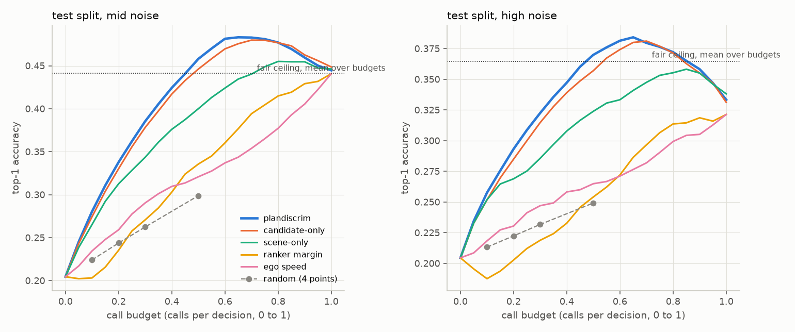
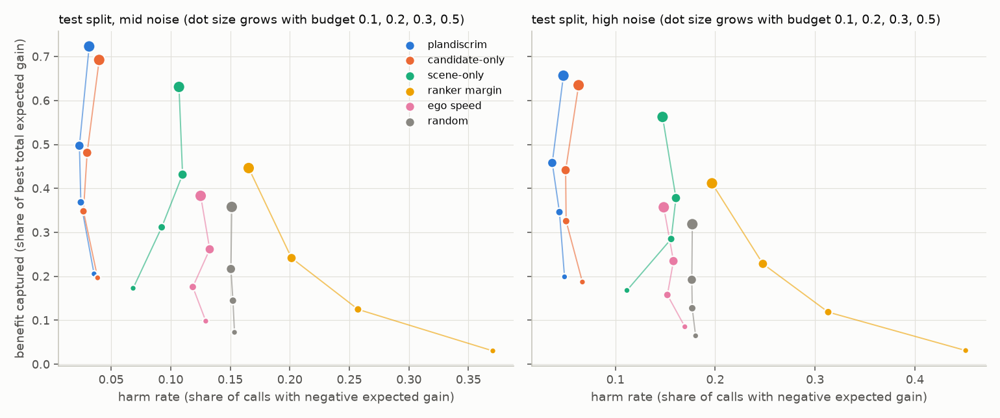

# Learned selector results digest

Written 2026-11-19 for the CMPE 249 project team. It reads existing result files only. Nothing was re-run.

## Sources and what the numbers mean

- `out/v3_eval/triggers.json` (written by `scripts/eval_triggers.py`, log in `out/v3_eval/triggers.log`). Key path used below: `results.<split>/<noise>.<policy>.<field>`.
- `out/v2_eval/vlm.json` and `out/v2_eval/vlm_extra_train.json` (VLM features, before and after the extra training data).
- `docs/baseline_results.md`, `docs/phase5_vlm.md`, `out/v2_more_data.txt`, `out/eval/test.json` (older baselines and the data-size check).
- `tables.csv` in this folder has every headline number with its source key. `analyse.py`, `figures.py` and `build_results.py` in this folder make the tables and figures.

How to read a number. Accuracy means that the top candidate after the optional tool call equals the oracle best candidate. The headline figure `mean_acc` is the average accuracy over 21 call budgets, 0 to 1 in steps of 0.05, where a budget is the share of decisions that get one tool call. That is the area under the accuracy against budget curve. Splits are `val` (2,222 decisions) and `test` (2,235 decisions), each at low, mid and high tool noise. Learned selectors are averaged over 3 initialisation seeds. All learned selectors in `triggers.json` were trained on 25,036 rows (`n_train`), which is the 10,329 main rows plus the 14,707 extra rows (`wc -l` of `out/v2_dataset/train.jsonl` and `out/v2_extra_ds/train.jsonl`). They use expected-gain targets.

Harm rate is the share of made calls whose chosen tool has a negative expected gain. Benefit captured is the summed expected gain of the calls made, divided by the best expected gain summed over every decision (`scripts/eval_triggers.py`, docstring). The simple triggers all use the single tool that is best on train. The fair ceiling calls a tool where its expected gain is largest and never where no tool has a positive gain. It uses eight noise draws, so it is a reference point, not a strict bound (`docs/baseline_results.md`).

## What the learned selector is

PlanDiscrim is a small fixed MLP (`scripts/eval_baselines.py: fit_mlp`, settings frozen). It reads scene geometry plus features of how the K candidate trajectories differ (`cassvla/planning/features.py`). It is trained to predict the expected gain of each tool, which is the mean correctness over 8 noise draws. At each decision it calls the tool with the highest predicted gain, and decisions are ranked by that predicted gain to meet a budget. Two ablations use the same MLP: `scene_only` (scene features and ranker margin) and `candidate_only` (candidate features and margin) (`scripts/eval_triggers.py` docstring and `feats`).

## Headline table

Mean accuracy over budgets 0 to 1. Source: `out/v3_eval/triggers.json`, `results.<cell>.<policy>.mean_acc`.

| Policy | val/low | val/mid | val/high | test/low | test/mid | test/high |
|---|---|---|---|---|---|---|
| random | 0.394 | 0.341 | 0.282 | 0.357 | 0.300 | 0.249 |
| uncertainty_margin | 0.418 | 0.370 | 0.291 | 0.384 | 0.326 | 0.256 |
| ego_speed | 0.399 | 0.348 | 0.285 | 0.381 | 0.321 | 0.264 |
| candidate_spread | 0.399 | 0.347 | 0.285 | 0.381 | 0.321 | 0.264 |
| fixed_schedule | 0.394 | 0.348 | 0.287 | 0.368 | 0.313 | 0.257 |
| scene_only | 0.498 | 0.434 | 0.343 | 0.457 | 0.378 | 0.309 |
| candidate_only | 0.509 | 0.447 | 0.360 | 0.471 | 0.403 | 0.328 |
| plandiscrim | 0.517 | 0.454 | 0.368 | 0.481 | 0.407 | 0.333 |
| fair_ceiling | 0.553 | 0.493 | 0.398 | 0.513 | 0.441 | 0.365 |

Figure 1 plots the `curve` key of each policy for test at mid and high noise. Random has no stored curve, so its four budget points come from `by_budget`. The fair ceiling has no curve, only a mean, shown as a dotted line.

Findings from the table.

- PlanDiscrim beats every simple trigger in all six cells. The smallest margin is test/high, 0.333 against 0.264 for ego_speed.
- Of the simple triggers, no single one wins everywhere. Ranker margin is best in five of six cells and ego_speed in test/high. All of them are only about 0 to 0.03 above random (fixed_schedule is level with it in val/low), so they are weak.
- PlanDiscrim stays below the fair ceiling in every cell, by 0.029 to 0.039.
- PlanDiscrim falls below scene-only at budgets 0.9 to 1.0 in val/low, val/mid and test/low, and at 1.0 in test/mid and test/high (`curve` keys). The curves are not monotone. In test/mid, PlanDiscrim peaks at 0.483 at budget 0.65 and falls to 0.445 at budget 1.0 (`curve` in `triggers.json`). The other cells peak at 0.65 as well, except test/low at 0.75. Calling every decision with the predicted tool is worse than calling about two thirds of them. That is the case for a selector: more calls do not always help.

## How much of the gap to the ceiling the learned selector closes

Gap is the fair ceiling minus the best simple trigger in that cell, using `mean_acc`.

| Cell | Best simple trigger | Its acc | Ceiling | Gap | plandiscrim | Gap closed by plandiscrim | by candidate_only | by scene_only |
|---|---|---|---|---|---|---|---|---|
| val/low | uncertainty_margin | 0.418 | 0.553 | 0.135 | 0.517 | 73% | 67% | 59% |
| val/mid | uncertainty_margin | 0.370 | 0.493 | 0.123 | 0.454 | 69% | 63% | 52% |
| val/high | uncertainty_margin | 0.291 | 0.398 | 0.106 | 0.368 | 72% | 65% | 49% |
| test/low | uncertainty_margin | 0.384 | 0.513 | 0.128 | 0.481 | 75% | 68% | 56% |
| test/mid | uncertainty_margin | 0.326 | 0.441 | 0.115 | 0.407 | 70% | 67% | 45% |
| test/high | ego_speed | 0.264 | 0.365 | 0.101 | 0.333 | 68% | 63% | 45% |

PlanDiscrim closes 68% to 75% of the gap. Scene-only closes 45% to 59%. A gap closed this way is a share of one specific, noisy ceiling and it is only meaningful next to the simple triggers' weakness. This is exploratory, on one test split, and accuracy is not a safety measure. At 0.5 calls per decision in test/mid, PlanDiscrim reaches 0.458, which is above the 0.441 that the best single tool reaches when called on every decision (knowno rows at call rate 1.0 in `triggers.json`, `results.test/mid.knowno.0.05.acc`, see the knowno section). The always-on figure with all 3 tools is 0.452 in the older `out/eval/test.json` (`correct.mid.always_on.acc`, a different test set, see inconsistencies). The test of the equal-accuracy-with-fewer-calls criterion (H3) is left to the final test.

## Candidate-only against scene-only

| Cell | scene_only | candidate_only | plandiscrim | candidate - scene | plandiscrim - candidate | plandiscrim by_seed range |
|---|---|---|---|---|---|---|
| val/low | 0.498 | 0.509 | 0.517 | +0.011 | +0.008 | 0.5166 to 0.5173 |
| val/mid | 0.434 | 0.447 | 0.454 | +0.013 | +0.007 | 0.4519 to 0.4568 |
| val/high | 0.343 | 0.360 | 0.368 | +0.017 | +0.008 | 0.3682 to 0.3686 |
| test/low | 0.457 | 0.471 | 0.481 | +0.015 | +0.009 | 0.4805 to 0.4819 |
| test/mid | 0.378 | 0.403 | 0.407 | +0.026 | +0.004 | 0.4067 to 0.4073 |
| test/high | 0.309 | 0.328 | 0.333 | +0.019 | +0.005 | 0.3316 to 0.3329 |

Conditioning on the candidates carries the lead. Candidate-only beats scene-only in all six cells, by 0.011 to 0.026. Adding the scene features back (PlanDiscrim) adds only 0.004 to 0.009 more. So most of the gain over scene-only comes from candidate information alone. The 3-seed spread of PlanDiscrim is about 0.001 to 0.005, so the candidate-versus-scene gap is clear of seed noise, and the PlanDiscrim-versus-candidate gap is small but also above it. The lowest PlanDiscrim seed beats the highest candidate-only seed in all six cells, by 0.002 to 0.008 (`by_seed` of both policies). These are spreads over initialisation seeds only. `triggers.json` has no confidence intervals over episodes. The older run in `docs/baseline_results.md` has them, and its lead over scene-only was +0.011 to +0.017 with a lower bound only 0.002 to 0.009 above zero, so treat the lead as real but small.

## Harm rate and benefit captured

Each cell shows accuracy / harm rate / benefit captured at budgets 0.1, 0.2, 0.3 and 0.5. Source: `results.<cell>.<policy>.by_budget.<budget>.{acc,harm_rate,benefit_captured}`.

Test, mid noise.

| Policy (acc / harm rate / benefit captured) | 0.1 | 0.2 | 0.3 | 0.5 |
|---|---|---|---|---|
| random | 0.224 / 0.154 / 0.073 | 0.244 / 0.152 / 0.145 | 0.262 / 0.151 / 0.217 | 0.299 / 0.151 / 0.358 |
| uncertainty_margin | 0.203 / 0.370 / 0.030 | 0.235 / 0.257 / 0.125 | 0.271 / 0.202 / 0.242 | 0.336 / 0.166 / 0.446 |
| ego_speed | 0.234 / 0.130 / 0.098 | 0.259 / 0.119 / 0.176 | 0.290 / 0.133 / 0.262 | 0.321 / 0.125 / 0.383 |
| fixed_schedule | 0.212 / 0.072 / 0.023 | 0.237 / 0.154 / 0.116 | 0.274 / 0.138 / 0.229 | 0.324 / 0.129 / 0.398 |
| scene_only | 0.265 / 0.069 / 0.173 | 0.313 / 0.092 / 0.312 | 0.344 / 0.110 / 0.431 | 0.400 / 0.107 / 0.631 |
| candidate_only | 0.274 / 0.039 / 0.197 | 0.330 / 0.027 / 0.348 | 0.378 / 0.030 / 0.481 | 0.446 / 0.040 / 0.692 |
| plandiscrim | 0.280 / 0.036 / 0.206 | 0.338 / 0.025 / 0.368 | 0.385 / 0.023 / 0.497 | 0.458 / 0.032 / 0.723 |

Test, high noise.

| Policy (acc / harm rate / benefit captured) | 0.1 | 0.2 | 0.3 | 0.5 |
|---|---|---|---|---|
| random | 0.213 / 0.180 / 0.065 | 0.222 / 0.177 / 0.128 | 0.232 / 0.177 / 0.192 | 0.249 / 0.177 / 0.319 |
| uncertainty_margin | 0.188 / 0.451 / 0.031 | 0.203 / 0.313 / 0.119 | 0.219 / 0.248 / 0.228 | 0.254 / 0.197 / 0.412 |
| ego_speed | 0.218 / 0.170 / 0.085 | 0.230 / 0.152 / 0.158 | 0.247 / 0.158 / 0.235 | 0.265 / 0.148 / 0.357 |
| fixed_schedule | 0.211 / 0.072 / 0.020 | 0.222 / 0.163 / 0.107 | 0.239 / 0.160 / 0.207 | 0.259 / 0.164 / 0.364 |
| scene_only | 0.252 / 0.112 / 0.168 | 0.269 / 0.156 / 0.285 | 0.286 / 0.161 / 0.378 | 0.324 / 0.147 / 0.563 |
| candidate_only | 0.252 / 0.067 / 0.187 | 0.285 / 0.051 / 0.326 | 0.315 / 0.050 / 0.442 | 0.357 / 0.063 / 0.635 |
| plandiscrim | 0.258 / 0.049 / 0.199 | 0.293 / 0.044 / 0.346 | 0.323 / 0.037 / 0.458 | 0.370 / 0.048 / 0.656 |

- On test, at budgets 0.1 to 0.5, PlanDiscrim makes harmful calls on 2.3% to 3.6% of calls at mid noise and 3.7% to 4.9% at high noise. Scene-only makes them on 6.9% to 11.0% and 11.2% to 16.1%. Random makes them on about 15% and 18%. Ranker margin makes them on 17% to 37% at mid noise and 20% to 45% at high noise.
- At budget 0.1 ranker margin captures only 3% of the possible benefit at mid noise, against 20.6% for PlanDiscrim, with a harm rate of 0.370 against 0.036. A generic uncertainty trigger spends its first calls on decisions where a tool hurts.
- Candidate-only has about the same harm rate as PlanDiscrim and 1 to 3 points less benefit at budgets 0.3 and 0.5 (for example 0.692 against 0.723 at budget 0.5, test/mid). The lowest harm is therefore mostly a candidate-feature effect.
- A harm rate of 3% is still not zero. The selector can make an expected-negative call, and `harm_rate` counts expected gain, not realised outcomes.

## Per-family winners and losers

Test, mid noise.

| Family | plandiscrim | scene_only | Best simple trigger | pl - scene | pl - simple | Flag |
|---|---|---|---|---|---|---|
| ambiguous_light | 0.512 | 0.490 | candidate_spread 0.365 | +0.022 | +0.147 |  |
| lane_blockage | 0.671 | 0.603 | uncertainty_margin 0.534 | +0.068 | +0.137 |  |
| lead_brake_cutin | 0.272 | 0.262 | candidate_spread 0.260 | +0.010 | +0.013 |  |
| merge_closing_speed | 0.436 | 0.404 | candidate_spread 0.377 | +0.032 | +0.059 |  |
| occluded_cross_traffic | 0.297 | 0.272 | ego_speed 0.295 | +0.025 | +0.002 |  |
| occluded_pedestrian | 0.419 | 0.371 | uncertainty_margin 0.369 | +0.048 | +0.050 |  |

Test, high noise.

| Family | plandiscrim | scene_only | Best simple trigger | pl - scene | pl - simple | Flag |
|---|---|---|---|---|---|---|
| ambiguous_light | 0.439 | 0.447 | uncertainty_margin 0.323 | -0.008 | +0.116 | loses to scene_only |
| lane_blockage | 0.577 | 0.509 | fixed_schedule 0.441 | +0.067 | +0.135 |  |
| lead_brake_cutin | 0.237 | 0.224 | ego_speed 0.206 | +0.013 | +0.031 |  |
| merge_closing_speed | 0.255 | 0.239 | ego_speed 0.230 | +0.016 | +0.025 |  |
| occluded_cross_traffic | 0.282 | 0.264 | candidate_spread 0.265 | +0.018 | +0.018 |  |
| occluded_pedestrian | 0.347 | 0.300 | uncertainty_margin 0.288 | +0.047 | +0.058 |  |

Every cell where PlanDiscrim loses to scene_only or to a simple trigger, across all six val and test cells:

| Cell | Family | plandiscrim | scene_only | Best simple trigger | pl - scene | pl - simple |
|---|---|---|---|---|---|---|
| val/low | lead_brake_cutin | 0.287 | 0.285 | ego_speed 0.298 | +0.002 | -0.011 |
| test/low | lead_brake_cutin | 0.305 | 0.297 | candidate_spread 0.318 | +0.007 | -0.014 |
| test/low | occluded_cross_traffic | 0.327 | 0.299 | ego_speed 0.334 | +0.027 | -0.007 |
| test/high | ambiguous_light | 0.439 | 0.447 | uncertainty_margin 0.323 | -0.008 | +0.116 |

Reading the families.

- Lane blockage and occluded pedestrian are where candidate conditioning pays most. PlanDiscrim leads scene-only by 0.04 to 0.07 on lane_blockage and 0.047 to 0.056 on occluded_pedestrian in every cell.
- Ambiguous light, merge closing speed and lead_brake_cutin gain at most 0.032 over scene-only, and at low noise they gain under 0.02 on all three, so the margin and scene features already carry nearly all of it.
- `lead_brake_cutin` is the weak family. PlanDiscrim loses to ego_speed in val/low (0.287 against 0.298) and to candidate_spread in test/low (0.305 against 0.318), and the ceiling in this family is the lowest of the six.
- `occluded_cross_traffic` at test/low is below ego_speed (0.327 against 0.334), and at test/mid it is a tie (+0.002).
- `ambiguous_light` at test/high is the only loss to scene_only (0.439 against 0.447, -0.008). The 3-seed spread for the family is not stored, so this could be noise.
- Per-family numbers are averages over budgets within a family of 2,235 decisions split six ways, so some families have few episodes. `triggers.json` stores no family sample sizes.

## Knowno operating points against PlanDiscrim

The knowno trigger calls when the ranker margin falls below a threshold calibrated on train so that the uncalled top-1 is right at rate 1 minus alpha (`scripts/eval_triggers.py` docstring). It gives one point per alpha. Source: `results.<cell>.knowno.<alpha>`.

| Cell | alpha | Threshold | Call rate | knowno acc | plandiscrim at nearest budget (budget) |
|---|---|---|---|---|---|
| test/mid | 0.05 | inf | 1.0 | 0.4407 | 0.4447 (1.0) |
| test/mid | 0.1 | 6.9299 | 0.9982 | 0.4412 | 0.4447 (1.0) |
| test/mid | 0.2 | 6.9228 | 0.9978 | 0.4407 | 0.4447 (1.0) |
| test/high | 0.05 | inf | 1.0 | 0.3213 | 0.3333 (1.0) |
| test/high | 0.1 | 6.9299 | 0.9982 | 0.3217 | 0.3333 (1.0) |
| test/high | 0.2 | 6.9228 | 0.9978 | 0.3213 | 0.3333 (1.0) |
| val/mid | 0.05 | inf | 1.0 | 0.4689 | 0.4866 (1.0) |
| val/mid | 0.1 | 6.9299 | 0.9973 | 0.4685 | 0.4866 (1.0) |
| val/mid | 0.2 | 6.9228 | 0.9968 | 0.468 | 0.4866 (1.0) |

These points are degenerate. The calibrated threshold is 6.93 (or infinity), and almost every test decision has a margin below it, so the call rate is 0.997 to 1.0 for all three alphas, all six cells. Knowno therefore equals always calling the best single tool, and the comparison with PlanDiscrim is at budget 1.0, where PlanDiscrim is 0.004 to 0.023 higher (test/mid 0.4447 against 0.4407). That is the worst place on PlanDiscrim's curve. It is not a comparison at a useful budget. A likely cause, not checked here, is that the no-tool accuracy is low (0.2045 at budget 0 on test, `curve[0]`), so a 90% to 95% target cannot be met by leaving decisions uncalled. A usable knowno baseline needs a much lower target, or a threshold set to match PlanDiscrim's call rate. The ranker margin curve in Figure 1 is the full version of this baseline, and PlanDiscrim is never below the best simple trigger at any budget in any of the six cells (checked on the `curve` keys).

## VLM gains before and after extra data

Source: `out/v2_eval/vlm.json` (10,329 training rows, `n_train`) and `out/v2_eval/vlm_extra_train.json` (25,036 training rows), `results.<cell>.{geometry,geometry_vlm,fair_ceiling}.mean_acc`. The VLM features are 32 PCA dimensions of the mid-layer image-token mean from Qwen3.5-9B (`docs/phase5_vlm.md`).

| Cell | geometry (10,329 rows) | +VLM | gain | geometry (25,036 rows) | +VLM | gain | Share of gap to ceiling closed by VLM (25,036) |
|---|---|---|---|---|---|---|---|
| val/low | 0.515 | 0.522 | +0.0073 | 0.517 | 0.526 | +0.0099 | 27% |
| val/mid | 0.450 | 0.453 | +0.0031 | 0.454 | 0.459 | +0.0050 | 13% |
| val/high | 0.368 | 0.374 | +0.0060 | 0.368 | 0.374 | +0.0060 | 21% |
| test/low | 0.481 | 0.485 | +0.0045 | 0.481 | 0.487 | +0.0066 | 21% |
| test/mid | 0.407 | 0.413 | +0.0055 | 0.407 | 0.416 | +0.0086 | 25% |
| test/high | 0.333 | 0.339 | +0.0061 | 0.333 | 0.343 | +0.0100 | 31% |

- Both runs meet the decision rule (`decision_rule_met` is true in both files), and the VLM gain was positive for all 3 training seeds in every cell of the 25,036-row run (`by_seed`).
- The gain grew with more data in five of six cells and stayed at +0.006 in val/high. It rose from +0.003 to +0.007 to +0.005 to +0.010. In 25,036-row runs the VLM features close 13% to 31% of the gap to the ceiling, against 7% to 20% with 10,329 rows.
- The geometry-only selector barely changes with the extra data (at most 0.005 in any cell, for example val/mid 0.4498 to 0.4543 and test/mid 0.4074 to 0.4073), matching the finding in `docs/baseline_results.md` that data volume does not limit the geometry selector. The VLM features are what use the extra data.
- Geometry plus VLM reaches 0.416 at test/mid, which is 0.025 below the ceiling and 0.038 above scene-only.
- The prompted variant (the VLM picks a tool) called a tool on 7.7% to 8.2% of decisions and reached 0.208 at test/mid, with no-tool at 0.2045 (`out/v2_eval/vlm.json`, `results.test/mid.prompted`). It is not competitive.

## What is still weak

1. The selector is 2.9 to 3.9 points below the fair ceiling and 8 to 18 points below the oracle selector (`docs/baseline_results.md`). The ceiling is only a reference and uses eight draws.
2. The lead over scene-only is small, 0.019 to 0.030 over budgets (plandiscrim minus scene_only), and no confidence interval over episodes exists for the `triggers.json` run.
3. The candidate divergence features beyond candidate-only add only 0.004 to 0.009.
4. `lead_brake_cutin` is below simple triggers at low noise, and `ambiguous_light` at high noise is below scene-only. The ceiling in lead_brake_cutin is only about 0.32 at mid noise (`docs/baseline_results.md`).
5. The accuracy-versus-budget curve falls after a budget of about 0.65 in every cell. The selector has no stopping rule of its own: a budget has to be chosen.
6. The knowno comparison is not informative as run (degenerate thresholds).
7. High-noise accuracy is low in absolute terms: 0.333 over budgets and 0.370 at budget 0.5 for PlanDiscrim at test/high.
8. The final split (seeds 400-459) has been seen twice, and `out/v3_final` is incomplete, so no clean held-out number exists yet for these selectors.
9. Accuracy here is exact top-1 match with the oracle best candidate. It is not a safety or collision rate. The harm rate counts calls with negative expected accuracy gain.

## Questions for the next experiments

1. Does PlanDiscrim's lead over scene-only (+0.019 to +0.030) hold on the clean `out/v3_final` seeds? Is the interval over episodes clear of zero?
2. Can a stopping rule or a gain threshold, instead of a fixed budget, keep the selector at its 0.65-budget peak without choosing the budget by hand?
3. Which candidate features give the candidate-only lead, and does `flip_features.py` add to it (`--flip` option of `eval_triggers.py`)?
4. Why does PlanDiscrim lose on `lead_brake_cutin` at low noise, and does a family-specific feature help?
5. Does the VLM gain keep growing with the 9,682 retained rows of `out/v3_extra`, and does it hold on the final seeds? More data raised the VLM gain from +0.003 to +0.007 up to +0.005 to +0.010.
6. Can knowno be rerun with thresholds matched to PlanDiscrim's call rate, so the comparison is at a budget of 0.2 to 0.5?
7. Do per-family selectors, or a family-aware ceiling, show whether the 0.03 gap to the ceiling is noise or learnable?

## Inconsistencies found between files

- `docs/baseline_results.md` says its headline numbers come from 2,909 decisions on seeds 400-459 (`no tool` 0.227), but `out/eval/test.json` has n=2288 on 45 seeds and no-tool 0.2006, and the `triggers.json` test split has 2,235 decisions with no-tool 0.2045. These are three different test sets. `out/eval/*.json` is the oldest run (first dataset) and should not be compared with `triggers.json`.
- `docs/phase5_vlm.md` lists training on the extra seeds as not yet tried, but `out/v2_eval/vlm_extra_train.json` exists and shows the result in the table above.
- `docs/phase5_vlm.md` and `docs/baseline_results.md` give 210 main training seeds, 10,329 rows. The `triggers.json` selectors were trained on 25,036 rows (510 seeds), so the headline table here is not directly comparable with the 10,329-row tables in those two docs. Between 10,329 and 25,036 rows the geometry selector moves by at most 0.005 (`vlm.json` against `vlm_extra_train.json`).
- `docs/baseline_results.md` measures the leads over 5 training seeds, while `triggers.json` and the VLM files use 3.
- The `docs/baseline_results.md` always-on figure counts 3 calls per decision, while the budgets in `triggers.json` count the share of decisions that get one call, so the two accuracy-per-cost scales differ by a factor of three.
