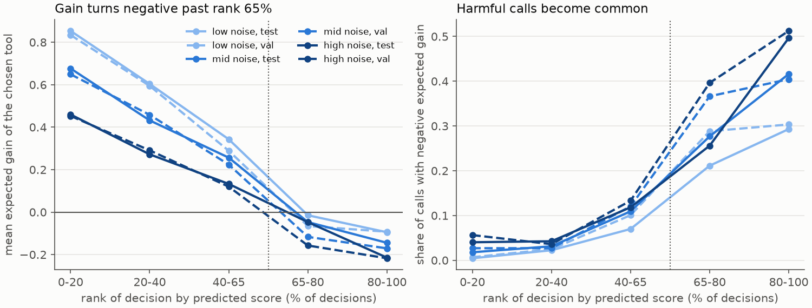
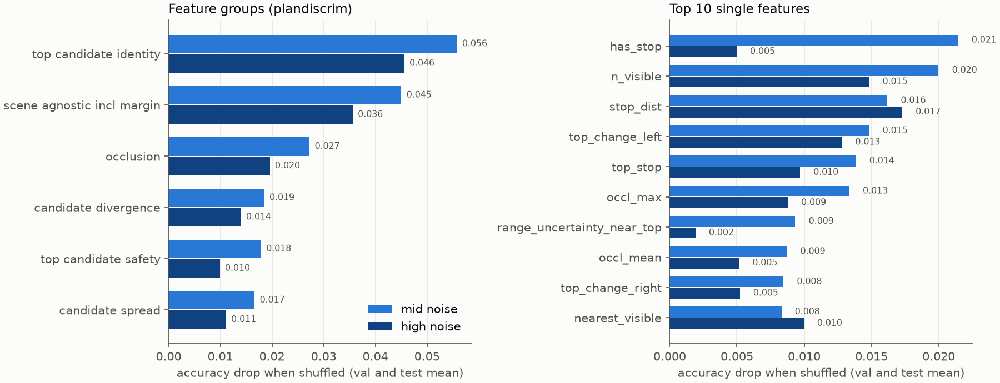

# Where and why the learned selector fails

Written 2026-11-19 for the project team. It analyses the frozen `plandiscrim` MLP on val and test only. Nothing here touches `out/v3_final*`.

## Setup and how to read the numbers

`run.py` retrains the frozen MLP with the settings and training data of `scripts/eval_triggers.py`: 25,036 rows from `out/v2_dataset` train and `out/v2_extra_ds` train, with expected-gain targets from `out/v2_expgain.jsonl` and `out/v2_extra_expgain.jsonl`. It reproduces the headline means in `out/v3_eval/triggers.json` to four decimals for `scene_only`, `plandiscrim` and `uncertainty_margin` in all six cells (the check is stored under `check_vs_triggers_json` in `results.json`). Every number below comes from `results.json`, which `run.py` writes. The tables in this file come from `md_tables.py` (copy in `tables.md`), and the figures come from `figures.py`.

Four conventions matter.

- Sections 1, 2, 3 and 4 use the model with init seed 0. Section 5 averages over init seeds 0 to 2, as `triggers.json` does.
- "Expected gain" of a tool on a decision is the mean correctness over 8 noise draws minus the no-tool correctness. A call is "harmful" when the chosen tool has a negative expected gain. A decision is "zero" when the chosen tool has an expected gain of exactly 0 (within 1e-9).
- "Ranks" order the decisions of a split by the model's top predicted score, so rank 65-100% is the lowest-scoring 35%, which is what a budget above 0.65 adds.
- Sections 1 and 2 use expected gains. Mean accuracy (section 3 and 5) uses the single realised noise draw stored in the dataset, as the headline does.

## 1. Why accuracy falls after a budget of about 0.65

Past rank 65% the model is calling on decisions where, on average, every tool loses accuracy. The model knows: its predicted score there is 0.08 to 0.13, against 0.39 to 0.67 in the first 65%. A fixed budget forces it to call anyway.

Figure 1 shows the gain of the chosen tool and the share of harmful calls by rank bin. Table T1 gives the 0-65% and 65-100% halves for each cell.

T1. Ranks 0-65% (early) against 65-100% (late), plandiscrim seed 0. Gains are expected gains.

| cell | early score | early gain of chosen | early harm | late n | late score | late gain of chosen | late best-tool gain | late harm | late zero | late positive | late no-tool correct | share of best gain in late |
|---|---|---|---|---|---|---|---|---|---|---|---|---|
| val/low | 0.6627 | 0.5506 | 0.0485 | 778 | 0.0833 | -0.081 | -0.0088 | 0.2969 | 0.5938 | 0.1093 | 0.545 | 0.0408 |
| val/mid | 0.5476 | 0.4266 | 0.063 | 778 | 0.1072 | -0.1477 | -0.0328 | 0.3882 | 0.4897 | 0.1221 | 0.5501 | 0.0534 |
| val/high | 0.3911 | 0.2748 | 0.0796 | 778 | 0.1153 | -0.1917 | -0.0683 | 0.4627 | 0.3766 | 0.1607 | 0.5347 | 0.0776 |
| test/low | 0.6741 | 0.5804 | 0.0351 | 783 | 0.1029 | -0.0605 | 0.0069 | 0.258 | 0.6271 | 0.1149 | 0.4725 | 0.0454 |
| test/mid | 0.5567 | 0.4398 | 0.0572 | 783 | 0.1238 | -0.1027 | 0.0014 | 0.3563 | 0.4623 | 0.1814 | 0.4662 | 0.0701 |
| test/high | 0.3938 | 0.2763 | 0.0709 | 783 | 0.1298 | -0.1427 | -0.0348 | 0.3934 | 0.3729 | 0.2337 | 0.4432 | 0.0989 |

Source for T1 to T3: `results.json`, `cells.<cell>.q1_*`.

What the late decisions are.

- About half of them are decisions the no-tool ranker already gets right (44% to 55%), and a tool can only keep that or break it. Another large part cannot be fixed by any tool, so the tool changes nothing. Together these give a zero gain on 37% to 63% of late calls.
- On 26% to 46% of late calls the chosen tool has a negative expected gain, against 3% to 8% in the first 65%. The mean gain of the chosen tool is -0.06 to -0.19. Even the best tool would gain only -0.07 to +0.01 on average, so this is mostly not a tool-choice error. The decisions simply do not benefit from a call. Section 2 confirms that tool choice is a minor part of the gap.
- Only 4% to 10% of the total best-tool gain lies in the late decisions (last column of T1). Dropping them loses almost nothing and avoids the harm, which is why the curve peaks near 0.65.
- Roi is chosen most often late at low noise (65% of late calls in val and test), depth at high noise (53% to 55%). Collision is almost never chosen (2% to 5%). All three tools lose on average, with roi worst in every cell (T2). Harmful-call share by tool in late ranks is 35% to 43% for roi and 36% to 47% for depth at mid and high noise (`q1_late_by_tool`).

T2. Late decisions, mean expected gain per tool and the mix of chosen tools.

| cell | gain if roi | gain if depth | gain if collision | chosen roi | chosen depth | chosen collision |
|---|---|---|---|---|---|---|
| val/low | -0.0946 | -0.0569 | -0.0601 | 0.6645 | 0.2905 | 0.045 |
| val/mid | -0.1713 | -0.108 | -0.097 | 0.5411 | 0.4422 | 0.0167 |
| val/high | -0.1893 | -0.1811 | -0.1525 | 0.4422 | 0.5308 | 0.027 |
| test/low | -0.0814 | -0.0356 | -0.039 | 0.645 | 0.3142 | 0.0409 |
| test/mid | -0.1389 | -0.0715 | -0.0712 | 0.4879 | 0.4955 | 0.0166 |
| test/high | -0.1502 | -0.1367 | -0.1173 | 0.4189 | 0.5453 | 0.0358 |

Which families. T3 gives harm share / mean expected gain of the chosen tool / share where no tool has a positive gain / n, for late decisions.

| family | val/mid | test/mid | val/high | test/high |
|---|---|---|---|---|
| ambiguous_light | 0.17 / -0.04 / 0.94 / 111 | 0.17 / -0.01 / 0.83 / 111 | 0.28 / -0.07 / 0.89 / 114 | 0.30 / -0.06 / 0.79 / 109 |
| lane_blockage | 0.66 / -0.23 / 0.96 / 112 | 0.70 / -0.23 / 0.98 / 104 | 0.92 / -0.37 / 0.95 / 105 | 0.85 / -0.40 / 0.95 / 99 |
| lead_brake_cutin | 0.36 / -0.16 / 0.69 / 231 | 0.35 / -0.16 / 0.66 / 274 | 0.36 / -0.17 / 0.57 / 225 | 0.33 / -0.14 / 0.54 / 267 |
| merge_closing_speed | 0.63 / -0.24 / 0.73 / 52 | 0.48 / +0.02 / 0.48 / 54 | 0.61 / -0.28 / 0.64 / 77 | 0.41 / -0.10 / 0.45 / 74 |
| occluded_cross_traffic | 0.13 / -0.05 / 0.91 / 173 | 0.15 / -0.01 / 0.88 / 168 | 0.22 / -0.08 / 0.75 / 162 | 0.18 / -0.03 / 0.75 / 158 |
| occluded_pedestrian | 0.70 / -0.28 / 0.72 / 99 | 0.57 / -0.17 / 0.60 / 72 | 0.72 / -0.31 / 0.74 / 95 | 0.59 / -0.19 / 0.59 / 76 |

- `lane_blockage` is the worst case. In the late 35% it has 66% to 92% harmful calls and a mean gain of -0.23 to -0.40 (mid and high). Its late set has 99 to 112 decisions out of about 310, so roughly a third of the family is called late and is nearly all harmful.
- `occluded_pedestrian` and `merge_closing_speed` have 41% to 72% harmful late calls. `occluded_cross_traffic` and `ambiguous_light` have few (13% to 30%) because tools there rarely hurt: no tool has positive gain in 75% to 94% of their late decisions, but the call is mostly neutral.
- `lead_brake_cutin` is the largest group (225 to 274 late decisions) and has a steady 33% to 36% harm share.

## 2. Wrong decisions against wrong tool

For a budget b, the policy calls the top b share of decisions by its score. The ceiling calls the b share with the largest best-tool gain, and never a decision with no positive gain. The gap to the ceiling in expected accuracy splits exactly into two parts.

- (a) Wrong decisions: the ceiling's gain minus the gain the policy would get on its own calls if it used the best tool each time.
- (b) Wrong tool: that best-tool gain on its own calls minus the gain of the tools it chose.

Part (a) is written as the missed positive mass plus the loss on calls where no tool has positive gain. T4 shows the shares (plandiscrim seed 0, with scene_only in the last column). Source: `q2` in `results.json`. The column "calls inside ceiling set" understates agreement, because many decisions tie at the top gain and either choice is equally good in gain terms. The gain split already handles ties.

T4. Gap to the ceiling in expected accuracy, split into parts (a) and (b).

| cell | budget | gap | (a) wrong decisions | (b) wrong tool | calls inside ceiling set | calls with a non-best tool | calls with negative gain | scene_only [gap; shares] |
|---|---|---|---|---|---|---|---|---|
| val/low | 0.2 | 0.03313 | 0.0219 (66%) | 0.0112 (34%) | 0.491 | 0.241 | 0.0068 | [0.0577; a 82%; b 18%] |
| val/low | 0.5 | 0.09327 | 0.0627 (67%) | 0.0306 (33%) | 0.811 | 0.2754 | 0.0234 | [0.1326; a 78%; b 22%] |
| val/mid | 0.2 | 0.05547 | 0.0416 (75%) | 0.0138 (25%) | 0.5676 | 0.2815 | 0.027 | [0.0752; a 83%; b 17%] |
| val/mid | 0.5 | 0.09811 | 0.0582 (59%) | 0.0399 (41%) | 0.7948 | 0.3456 | 0.0387 | [0.1389; a 72%; b 28%] |
| val/high | 0.2 | 0.05063 | 0.0354 (70%) | 0.0152 (30%) | 0.5518 | 0.2883 | 0.0563 | [0.0787; a 78%; b 22%] |
| val/high | 0.5 | 0.08753 | 0.0479 (55%) | 0.0396 (45%) | 0.7615 | 0.3348 | 0.0576 | [0.1337; a 68%; b 32%] |
| test/low | 0.2 | 0.02931 | 0.0213 (73%) | 0.0080 (27%) | 0.5101 | 0.2192 | 0.0045 | [0.0551; a 84%; b 16%] |
| test/low | 0.5 | 0.10117 | 0.0747 (74%) | 0.0265 (26%) | 0.8014 | 0.2612 | 0.0224 | [0.1432; a 83%; b 17%] |
| test/mid | 0.2 | 0.04955 | 0.0379 (76%) | 0.0117 (24%) | 0.5682 | 0.2796 | 0.0179 | [0.0736; a 85%; b 15%] |
| test/mid | 0.5 | 0.09838 | 0.0633 (64%) | 0.0351 (36%) | 0.7791 | 0.3157 | 0.0322 | [0.1454; a 76%; b 24%] |
| test/high | 0.2 | 0.04877 | 0.0352 (72%) | 0.0135 (28%) | 0.566 | 0.302 | 0.0403 | [0.0798; a 81%; b 19%] |
| test/high | 0.5 | 0.08898 | 0.0526 (59%) | 0.0364 (41%) | 0.7478 | 0.3462 | 0.0483 | [0.1361; a 69%; b 31%] |

- Wrong decisions dominate. At budget 0.2, 66% to 76% of plandiscrim's gap is part (a) and 24% to 34% is part (b). At budget 0.5, part (a) is 55% to 74% and part (b) is 26% to 45%.
- Part (b) grows with noise and budget. At budget 0.5 it is 33% at low noise (val) and 41% to 45% at high noise. The share of calls that use a non-best tool is 22% to 35% in all cells (T4, "calls with a non-best tool").
- Scene-only has a larger gap at both budgets, and almost all of the extra is part (a): 68% to 85% of its gap. So the candidate features mainly improve which decisions to call, and the tool choice is similar for both (scene_only "non-best tool" rates are 21% to 37%).
- At budget 0.5, in absolute terms plandiscrim loses 0.027 to 0.040 of expected accuracy to wrong tools and 0.048 to 0.075 to wrong decisions. A perfect tool chooser alone would lift test/mid at budget 0.5 by 0.035, and a perfect decision ranker alone by 0.063.

## 3. Feature importance

Each feature (or group) of the evaluation split is shuffled across decisions, the same permutation for every column in a group, and the model is evaluated again. The score is the mean accuracy over the 21 budgets, and the number is the drop from the unshuffled model. Each value averages 10 shuffles (`NREP` in `run.py`). Source: `q3` in `results.json`. The groups are:

- candidate divergence: `div_*`, `runner_*`, `light_splits_top2` (10 features)
- top candidate identity: `top_keep` to `top_change_right` and `top_is_change`
- top candidate safety: `frac_pred_safe`, `top_clearance`, `top_ttc`, `n_near_threshold`, `range_uncertainty_near_top`
- occlusion: `occl_top`, `occl_mean`, `occl_max`, `stop_in_reach_light_unknown`
- candidate spread: `endpoint_spread`, `progress_spread`
- scene and margin: the 11 scene-agnostic features including `margin`.

Findings (drops in mean accuracy over budgets, mean of val and test, plandiscrim):

- Which candidate the ranker picked matters most: the top-candidate identity group costs 0.056 at mid noise and 0.046 at high. Scene and margin features cost 0.045 and 0.036. Occlusion costs 0.027 and 0.020.
- The candidate divergence group costs 0.019 at mid and 0.014 at high noise. Single divergence features are small (T8). At mid noise `div_time` costs 0.0067, `runner_ttc` 0.0030, `runner_safe` 0.0029 and `runner_is_change` 0.0028. `div_progress` is slightly negative (-0.0006), so the model does not use it. At high noise every divergence feature is 0.003 or less.
- `margin`, the ranker's top-two score gap, costs only 0.0008 (mid) and 0.0010 (high) when shuffled inside plandiscrim, although it is the most important single feature in scene_only at high noise (0.021 to 0.023). The candidate features hold the same information.
- Importance falls with noise for most features (has_stop falls from 0.021 to 0.005, `range_uncertainty_near_top` from 0.009 to 0.002), but the order of groups stays the same. At high noise the model leans on the geometry of the light and stop line (`stop_dist` 0.017) and on visible-actor counts.
- Scene-only depends on the whole scene group by 0.055 (val) and 0.048 (test) at high noise, and by 0.081 and 0.061 at mid. The single leaders are `n_visible`, `margin`, `stop_dist`, `has_stop` and `nearest_visible` (T7).

T7. Permutation importance, drop in mean accuracy over budgets (val and test). Groups first, then the top 10 single features. All units are in `results.json` (`q3`).

**plandiscrim, mid noise** (base 0.4541 val, 0.4086 test)

| unit | val | test |
|---|---|---|
| group: top_candidate_identity | 0.05733 | 0.05426 |
| group: scene_agnostic_incl_margin | 0.04547 | 0.04459 |
| group: occlusion | 0.02783 | 0.02672 |
| group: candidate_divergence | 0.01657 | 0.02045 |
| group: top_candidate_safety | 0.01733 | 0.01844 |
| group: candidate_spread | 0.01565 | 0.01763 |
| has_stop | 0.02128 | 0.0216 |
| n_visible | 0.02142 | 0.01856 |
| stop_dist | 0.01591 | 0.01645 |
| top_change_left | 0.01524 | 0.01441 |
| top_stop | 0.01441 | 0.01327 |
| occl_max | 0.01369 | 0.01302 |
| range_uncertainty_near_top | 0.0096 | 0.00907 |
| occl_mean | 0.00857 | 0.00885 |
| top_change_right | 0.00877 | 0.00814 |
| nearest_visible | 0.00954 | 0.00707 |

**plandiscrim, high noise** (base 0.3681 val, 0.3329 test)

| unit | val | test |
|---|---|---|
| group: top_candidate_identity | 0.04849 | 0.0427 |
| group: scene_agnostic_incl_margin | 0.0362 | 0.03504 |
| group: occlusion | 0.01816 | 0.021 |
| group: candidate_divergence | 0.01253 | 0.01545 |
| group: candidate_spread | 0.01357 | 0.00863 |
| group: top_candidate_safety | 0.00827 | 0.01154 |
| stop_dist | 0.01555 | 0.01902 |
| n_visible | 0.01486 | 0.01478 |
| top_change_left | 0.0122 | 0.01338 |
| nearest_visible | 0.01266 | 0.00726 |
| top_stop | 0.01054 | 0.00883 |
| occl_max | 0.00892 | 0.00862 |
| top_ttc | 0.00725 | 0.00685 |
| stop_in_reach_light_unknown | 0.00735 | 0.00614 |
| top_keep_fast | 0.0052 | 0.00654 |
| top_change_right | 0.0052 | 0.00522 |

**scene_only, mid noise** (base 0.4325 val, 0.3789 test)

| unit | val | test |
|---|---|---|
| group: scene_agnostic_incl_margin | 0.08098 | 0.0613 |
| n_visible | 0.03058 | 0.02541 |
| margin | 0.02923 | 0.02418 |
| stop_dist | 0.02313 | 0.02564 |
| has_stop | 0.02273 | 0.01948 |
| nearest_visible | 0.02196 | 0.01793 |
| ego_speed | 0.01238 | 0.01203 |
| light_known | 0.00308 | 0.00314 |
| light_green | 0.00143 | 0.00311 |
| light_yellow | 0.00218 | 0.00131 |
| light_red | 0.00099 | 0.00046 |

**scene_only, high noise** (base 0.3424 val, 0.3095 test)

| unit | val | test |
|---|---|---|
| group: scene_agnostic_incl_margin | 0.05502 | 0.04789 |
| margin | 0.02273 | 0.02078 |
| n_visible | 0.01789 | 0.01769 |
| stop_dist | 0.00893 | 0.01708 |
| nearest_visible | 0.00903 | 0.01478 |
| has_stop | 0.00844 | 0.0116 |
| ego_speed | 0.00614 | 0.00871 |
| light_known | 0.0055 | 0.00655 |
| light_green | 0.00156 | 0.00257 |
| light_yellow | 0.0005 | 0.00125 |
| light_red | 0.00035 | 0.00022 |

T8. Divergence features one at a time, mean of val and test, plandiscrim.

| feature | mid | high |
|---|---|---|
| div_time | 0.0067 | 0.0021 |
| div_occl | 0.0014 | 0.0014 |
| div_actor_near | 0.0016 | 0.0011 |
| div_lateral | 0.0002 | 0.0018 |
| div_progress | -0.0006 | -0.0002 |
| runner_safe | 0.0029 | 0.0017 |
| runner_clearance | 0.0011 | 0.0013 |
| runner_ttc | 0.003 | 0.003 |
| runner_is_change | 0.0028 | 0.0007 |
| light_splits_top2 | 0.0016 | 0.0018 |

## 4. Predicted tool against best tool, per family

The "best tool" is the tool with the largest expected gain, or "none" when no tool has a positive gain. Ties go to the first tool in the order roi, depth, collision, so the argmax counts below favour roi. The tool-optimal rate counts any tool that ties for the best. The matrices are in `q4` in `results.json`. T9 pools val and test at mid noise. Mean regret is the best gain minus the chosen gain over decisions where a tool helps.

T9. Per family, mid noise, val and test pooled.

| family | n | share where no tool helps | predicted tool counts | best tool counts (argmax, ties to roi first) | exact-argmax agreement | tool-optimal rate (ties count) | mean regret |
|---|---|---|---|---|---|---|---|
| ambiguous_light | 575 | 0.54 | roi 389, depth 173, coll 13 | roi 162, depth 81, coll 22 | 0.72 | 0.78 | 0.055 |
| lane_blockage | 618 | 0.40 | roi 52, depth 419, coll 147 | roi 86, depth 203, coll 80 | 0.39 | 0.60 | 0.087 |
| lead_brake_cutin | 1446 | 0.41 | roi 270, depth 1117, coll 59 | roi 284, depth 418, coll 155 | 0.48 | 0.56 | 0.083 |
| merge_closing_speed | 733 | 0.19 | roi 45, depth 679, coll 9 | roi 72, depth 377, coll 143 | 0.64 | 0.68 | 0.068 |
| occluded_cross_traffic | 471 | 0.74 | roi 141, depth 316, coll 14 | roi 13, depth 89, coll 21 | 0.72 | 0.73 | 0.073 |
| occluded_pedestrian | 614 | 0.21 | roi 191, depth 396, coll 27 | roi 178, depth 202, coll 103 | 0.48 | 0.54 | 0.106 |

T10. Per tool (mid and high noise).

| cell | tool | decisions where it is the unique-or-first best | predicted tool when it is best (roi, depth, collision) | times predicted | share of predictions that are tool-optimal |
|---|---|---|---|---|---|
| val/mid | roi | 394 | [0.2919, 0.6624, 0.0457] | 578 | 0.6471 |
| val/mid | depth | 649 | [0.0308, 0.8459, 0.1233] | 1514 | 0.6367 |
| val/mid | collision | 272 | [0.0699, 0.8713, 0.0588] | 130 | 0.5308 |
| test/mid | roi | 401 | [0.2918, 0.6334, 0.0748] | 510 | 0.6471 |
| test/mid | depth | 721 | [0.0472, 0.8599, 0.0929] | 1586 | 0.6658 |
| test/mid | collision | 252 | [0.0635, 0.8452, 0.0913] | 139 | 0.4964 |
| val/high | roi | 513 | [0.2515, 0.7466, 0.0019] | 498 | 0.6124 |
| val/high | depth | 668 | [0.0509, 0.9296, 0.0195] | 1681 | 0.6127 |
| val/high | collision | 220 | [0.0727, 0.8909, 0.0364] | 43 | 0.5581 |
| test/high | roi | 532 | [0.218, 0.7744, 0.0075] | 439 | 0.6538 |
| test/high | depth | 701 | [0.0471, 0.9287, 0.0243] | 1740 | 0.6034 |
| test/high | collision | 243 | [0.0494, 0.9177, 0.0329] | 56 | 0.6071 |

- The model prefers depth. Over mid noise it predicts depth on 1514 of 2222 val decisions and 1586 of 2235 test decisions (T10), and 92% to 93% of predictions in `merge_closing_speed`. Collision is predicted on 130 (val) and 139 (test) decisions, although it is the best tool on 272 (val) and 252 (test) decisions.
- When roi is best, the model predicts depth about 63% to 77% of the time and roi 22% to 29% (T10). When collision is best it predicts depth 84% to 93%. So collision and roi cases are folded into depth.
- Per-family tool-optimal rates are lowest in `occluded_pedestrian` (0.54, regret 0.106), `lead_brake_cutin` (0.56, regret 0.083) and `lane_blockage` (0.60, regret 0.087). They are highest in `ambiguous_light` (0.78) and `occluded_cross_traffic` (0.73).
- In `lane_blockage`, depth and collision are close cousins: the model picks depth for 419 of 618 decisions while collision is the best tool on 80 and depth on 203. Among decisions where a tool helps, the largest wrong block is collision predicted when depth is best (85 decisions), followed by depth predicted when roi is best (55) or when collision is best (53), from the pooled matrices.
- The "no tool helps" label covers 54% of `ambiguous_light` and 74% of `occluded_cross_traffic` at mid noise, but only 19% to 21% of `merge_closing_speed` and `occluded_pedestrian`. In `lane_blockage` 40% of decisions need no tool, and the late calls there are the most harmful (T3), so the missing abstention hurts most where the no-call share is moderate and tools hurt when wrongly applied.

## 5. How noisy are the per-cell numbers

The interval is a bootstrap over scenario seeds (1000 resamples, `E.seed_boot` with generator seed 0). Each resample draws seeds with replacement, so the 45 seeds in each split are the unit, not the 2,200 correlated decisions. The statistic is the per-decision accuracy averaged over the 21 budgets and the 3 init seeds. Source: `q5` in `results.json`. The seed variable is the scenario seed alone, so seeds shared between families form a cluster, which is the conservative choice.

T5. Mean difference and 95% interval.

| cell | minus scene_only | minus uncertainty_margin | seeds |
|---|---|---|---|
| val/low | +0.0187 [+0.0127, +0.0249] | +0.0988 [+0.0845, +0.1148] | 45 |
| val/mid | +0.0199 [+0.0133, +0.0267] | +0.0844 [+0.0711, +0.0978] | 45 |
| val/high | +0.0250 [+0.0195, +0.0309] | +0.0767 [+0.0631, +0.0918] | 45 |
| test/low | +0.0241 [+0.0188, +0.0297] | +0.0964 [+0.0843, +0.1087] | 45 |
| test/mid | +0.0298 [+0.0237, +0.0360] | +0.0810 [+0.0695, +0.0932] | 45 |
| test/high | +0.0236 [+0.0180, +0.0288] | +0.0763 [+0.0660, +0.0878] | 45 |

- Both leads are clear of zero in all six cells. The interval half-width is about 0.006 for scene-only and 0.011 to 0.015 for the ranker margin. The lead over scene-only is therefore 0.019 to 0.030, with a lower bound of 0.013 to 0.024. The earlier digest said no interval over episodes existed for this run; this is it.
- The per-cell sampling noise, about plus or minus 0.006, is of the same size as the gap between PlanDiscrim and candidate-only that the digest reports (0.004 to 0.009). I did not test that pair, so treat it as unresolved.

T6. Plandiscrim minus scene_only by family (a * marks an interval that includes zero).

| family | val/low | val/mid | val/high | test/low | test/mid | test/high |
|---|---|---|---|---|---|---|
| ambiguous_light | +0.002* | +0.005* | +0.008* | +0.019 | +0.021 | -0.008* |
| lane_blockage | +0.061 | +0.042 | +0.052 | +0.061 | +0.068 | +0.067 |
| lead_brake_cutin | +0.002* | +0.004* | +0.006* | +0.007 | +0.010 | +0.013 |
| merge_closing_speed | +0.001* | +0.018 | +0.027 | +0.008* | +0.032 | +0.016 |
| occluded_cross_traffic | +0.016 | +0.019 | +0.026 | +0.027 | +0.025 | +0.018* |
| occluded_pedestrian | +0.055 | +0.053 | +0.056 | +0.048 | +0.048 | +0.047 |

- Only `lane_blockage` and `occluded_pedestrian` have intervals clear of zero in every cell. The `ambiguous_light` loss to scene-only at test/high (-0.008) is inside its interval, so it is noise. The `lead_brake_cutin` lead is 0.002 to 0.013 and only clear of zero in three of six cells.

## What the evidence supports

1. A stopping rule, which is the largest and cheapest win. Rank-65%-plus calls have predicted scores of 0.08 to 0.13 and a mean expected gain of -0.06 to -0.19. Stop at a score threshold rather than a fixed budget, tuned on val. The threshold has to lie above the late-region scores (0.08 to 0.13) and below the mean score of the 40-65% bin (0.39 to 0.40 at mid noise, `q1_by_rank`). Only 4% to 10% of total best-tool gain lies in that region (T1), so the upside is the gap between the curve's 0.65 peak and its end, and a threshold avoids choosing the budget by hand. This is a decision rule on the existing model, not a new learner.
2. Change the label so harm is visible. `eval_triggers.py` trains on the expected gain clipped to the range 0 to 1, so a tool that loses 0.4 and a tool that changes nothing get the same target of 0. In the late decisions 26% to 46% of calls are harmful and the mean gain of the chosen tool is -0.06 to -0.19, yet the model scores them 0.08 to 0.13. A target that keeps the negative part (for example a regression on the signed gain, or an extra penalty on predicted gain where the true gain is negative), or an explicit no-call output next to the three tools, matches this failure. This is a suggestion from the evidence, not something I tested.
3. Part (a), the choice of decision, is 55% to 76% of the gap to the ceiling, so features that separate "tool will help" from "no tool helps" pay more than features that choose the tool. The most used signals are which candidate the ranker chose, the stop-line geometry and the occlusion features. Feature ideas that follow from the importance table (untested): the clearance and time-to-collision of the runner-up relative to the top candidate, since `runner_ttc` and `runner_safe` are the strongest divergence features after `div_time`; a per-candidate stop-reach flag, because `has_stop` and `stop_dist` are among the top single features; and a count of how many of the six candidates the ranker rates safe, to tell families where nothing needs checking from ones where a call is needed.
4. Tool choice (part (b), 24% to 45% of the gap) is collapsed onto depth. Roi is best on about 400 to 530 decisions per split and collision on 220 to 270, but collision is predicted on 43 to 139. A per-tool loss weight or a per-tool score offset is worth a try. These are hypotheses.
5. `div_progress` has a slightly negative importance and `margin` adds nothing once the candidate features are present. These can be dropped without a measured cost on the first check, but that needs an ablation to confirm; it was not run here.
6. Report intervals. The lead over scene-only (+0.019 to +0.030) and over the ranker margin (+0.076 to +0.099) hold in every cell with a 45-seed bootstrap. The family-level claims for `ambiguous_light`, `lead_brake_cutin` and `merge_closing_speed` are not resolved by this data.

## Limits

- Sections 1 to 4 use one init seed. The 3-seed spread of the headline is 0.001 to 0.005, so the tables could move in the last digit.
- Expected gains come from 8 draws per decision, so a gain of exactly 0 can be a sampling tie. The ceiling and the decomposition are defined on these gains and are references, not bounds on realised accuracy.
- The evidence for the new features in the last section is correlational. Permutation importance can understate features that are correlated with others (`margin` against the candidate features).
- Realised accuracy is exact top-1 match with the oracle best candidate, not a collision rate.

## Files

All in `research/2026-11-19_learned_selector/analysis2/`: `run.py` (analysis, writes `results.json`), `tables.py` and `md_tables.py` (print tables, `tables.md`), `figures.py` (`fig_late_ranks.png`, `fig_permutation.png`).
