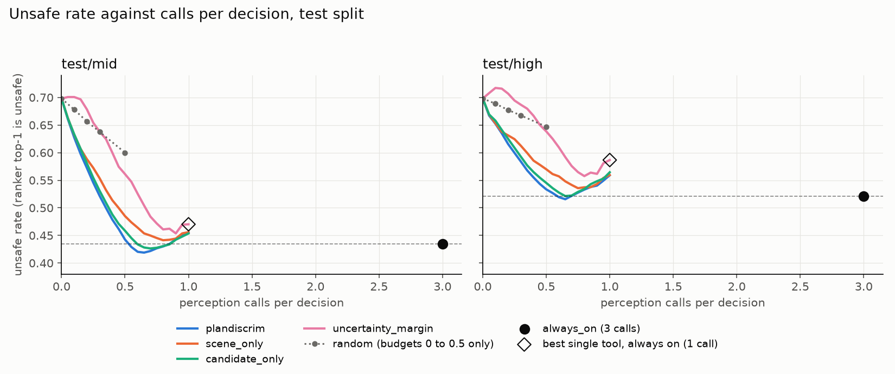

# Does trajectory-conditioned tool selection keep safety with fewer calls?

Written 2026-11-19 for the project team and the professor. It reads one file, `out/v3_eval/dev/triggers_v2.json` (keys under `results.<split>/<level>`), and does arithmetic on it. Nothing was retrained, and nothing here touches `out/v3_final*`. The scripts are `calc.py`, `tables.py` and `fig.py` in this folder, and `calc.json` holds the intermediate numbers.

## Definitions

- **Calls per decision.** A budget b means that a fraction b of decisions gets one tool call, so the cost is b calls per decision. The `always_on` policy calls all three tools on every decision, so its cost is 3. As a share of `always_on`, a budget b costs b/3. The budget grid runs from 0 to 1 in steps of 0.05 (`curve`, `unsafe_curve`).
- **Best single tool, always on.** This is the budget-1.0 point of the fixed-tool triggers (`uncertainty_margin`, `ego_speed`, `candidate_spread`). All three give the same value in every cell, so I read it from `uncertainty_margin.curve[-1]` and `.unsafe_curve[-1]`. It costs 1 call per decision. The tool is the one with the best mean gain on train, chosen separately for each noise level.
- **Accuracy** is the share of decisions where the ranker's top candidate equals the oracle's best candidate (`correct`). 
- **Unsafe** is the share of decisions where the ranker's top candidate is unsafe. In `cassvla/planning/labels.py`, `_outcome` sets `unsafe = not m[top]["safe"]`, where `m` is the oracle record's per-candidate metrics. So unsafe is the oracle's safety label applied to the candidate that the ranker picked. It is not a judgement by the selector or by the ranker.
- A target is "reached" at the smallest budget whose value is at least `always_on.acc`, or at most `always_on.unsafe`. "Both" needs both on the same budget. "Not reached" means no budget up to 1.0 qualifies.
- `random` has only the budgets 0.1, 0.2, 0.3 and 0.5 in the file (`random.by_budget`), so I cannot say where it would reach anything above 0.5. The no-tool point is the budget-0 entry of the learned curves.

## 1. Calls needed to match always_on

T1 gives the references (`always_on`, and the budget-1.0 point of `uncertainty_margin`).

| cell | always_on accuracy | always_on unsafe | best single accuracy | best single unsafe |
|---|---|---|---|---|
| val/low | 0.5954 | 0.3078 | 0.5707 | 0.3479 |
| val/mid | 0.4968 | 0.3960 | 0.4689 | 0.4496 |
| val/high | 0.3470 | 0.4955 | 0.3344 | 0.5752 |
| test/low | 0.5781 | 0.3369 | 0.5593 | 0.3624 |
| test/mid | 0.4537 | 0.4345 | 0.4407 | 0.4702 |
| test/high | 0.3378 | 0.5213 | 0.3213 | 0.5866 |

Calling all three tools beats the best single tool on both measures in every cell. The comparison is therefore stricter than "one good tool".

The three tables below give calls per decision. Divide by 3 for the share of `always_on`. The best single tool costs 1 call, so these numbers are also the fraction of its cost.

T2a. Calls per decision to reach `always_on` accuracy.

| cell | plandiscrim | scene_only | candidate_only | uncertainty_margin |
|---|---|---|---|---|
| val/low | 0.55 | 0.75 | 0.65 | not reached |
| val/mid | 0.50 | 0.65 | 0.55 | not reached |
| val/high | 0.25 | 0.40 | 0.30 | not reached |
| test/low | 0.65 | not reached | 0.80 | not reached |
| test/mid | 0.50 | 0.80 | 0.55 | not reached |
| test/high | 0.40 | 0.65 | 0.40 | not reached |

T2b. Calls per decision to reach `always_on` unsafe rate.

| cell | plandiscrim | scene_only | candidate_only | uncertainty_margin |
|---|---|---|---|---|
| val/low | 0.60 | 0.75 | 0.60 | not reached |
| val/mid | 0.50 | 0.65 | 0.60 | not reached |
| val/high | 0.50 | not reached | 0.55 | not reached |
| test/low | 0.65 | not reached | 0.70 | not reached |
| test/mid | 0.55 | not reached | 0.60 | not reached |
| test/high | 0.60 | not reached | 0.65 | not reached |

T2c. Calls per decision to reach both at the same budget.

| cell | plandiscrim | scene_only | candidate_only | uncertainty_margin |
|---|---|---|---|---|
| val/low | 0.60 | 0.75 | 0.65 | not reached |
| val/mid | 0.50 | 0.65 | 0.60 | not reached |
| val/high | 0.50 | not reached | 0.55 | not reached |
| test/low | 0.65 | not reached | 0.80 | not reached |
| test/mid | 0.55 | not reached | 0.60 | not reached |
| test/high | 0.60 | not reached | 0.65 | not reached |

T2d. Plandiscrim's cost for "both" as a share of `always_on`'s 3 calls: val/low 20%, val/mid 17%, val/high 17%, test/low 22%, test/mid 18%, test/high 20%. For candidate_only it is 22%, 20%, 18%, 27%, 20% and 22%, and scene_only reaches both only in val/low (25%) and val/mid (22%). Relative to the best single tool, plandiscrim needs 0.50 to 0.65 of its 1 call, which is 50% to 65%.

What this says.

- The `uncertainty_margin` trigger never reaches `always_on` on accuracy, unsafe rate or both, in any of the six cells. Its curves end at the best-single-tool point, which is below `always_on`.
- `random` is far from `always_on` at every budget it reports. At budget 0.5 in test/mid its accuracy is 0.2988 against `always_on`'s 0.4537, and its unsafe rate is 0.5999 against 0.4345 (`random.by_budget`).
- Plandiscrim reaches both targets in all six cells, at 0.50 to 0.65 calls per decision. The two other learned selectors need more calls or fail in the test cells. The gap between plandiscrim and candidate_only is 0.05 to 0.15 calls, which is small.
- At those budgets plandiscrim is also better than the best single tool on both measures. In test/mid at budget 0.55 it has accuracy 0.4701 and unsafe 0.4291, against 0.4407 and 0.4702 for the best single tool that costs 1 call.
- Exact thresholds in this table are sensitive to the 0.05 grid, and the margin over `always_on` at the crossing is small (for example 0.458 against 0.4537 in test/mid). Read them as "about half a call per decision".

## 2. Unsafe rate by budget

T3 gives the unsafe rate at four budgets (`unsafe_curve` at index budget/0.05; `random.by_budget[b].unsafe`). The no-tool rate (budget 0) is 0.6418 on val and 0.6980 on test for every learned policy and `uncertainty_margin`.

| cell | budget | plandiscrim | scene_only | candidate_only | uncertainty_margin | random |
|---|---|---|---|---|---|---|
| val/low | 0.1 | 0.5578 | 0.5632 | 0.5615 | 0.6377 | 0.6153 |
| val/low | 0.2 | 0.4880 | 0.5002 | 0.4991 | 0.6130 | 0.5883 |
| val/low | 0.3 | 0.4563 | 0.4764 | 0.4703 | 0.5860 | 0.5608 |
| val/low | 0.5 | 0.3236 | 0.3579 | 0.3410 | 0.4617 | 0.5074 |
| val/mid | 0.1 | 0.5762 | 0.5788 | 0.5786 | 0.6512 | 0.6237 |
| val/mid | 0.2 | 0.5182 | 0.5363 | 0.5264 | 0.6341 | 0.6084 |
| val/mid | 0.3 | 0.4935 | 0.5146 | 0.5035 | 0.6071 | 0.5916 |
| val/mid | 0.5 | 0.3887 | 0.4229 | 0.4091 | 0.5081 | 0.5582 |
| val/high | 0.1 | 0.5957 | 0.5996 | 0.5984 | 0.6634 | 0.6350 |
| val/high | 0.2 | 0.5650 | 0.5842 | 0.5732 | 0.6625 | 0.6275 |
| val/high | 0.3 | 0.5497 | 0.5734 | 0.5597 | 0.6467 | 0.6195 |
| val/high | 0.5 | 0.4887 | 0.5242 | 0.5045 | 0.5945 | 0.6044 |
| test/low | 0.1 | 0.6155 | 0.6203 | 0.6179 | 0.6917 | 0.6676 |
| test/low | 0.2 | 0.5399 | 0.5476 | 0.5523 | 0.6577 | 0.6362 |
| test/low | 0.3 | 0.5042 | 0.5235 | 0.5212 | 0.6260 | 0.6069 |
| test/low | 0.5 | 0.3692 | 0.4045 | 0.3842 | 0.5092 | 0.5480 |
| test/mid | 0.1 | 0.6273 | 0.6324 | 0.6332 | 0.7007 | 0.6779 |
| test/mid | 0.2 | 0.5720 | 0.5881 | 0.5805 | 0.6783 | 0.6565 |
| test/mid | 0.3 | 0.5456 | 0.5724 | 0.5544 | 0.6541 | 0.6377 |
| test/mid | 0.5 | 0.4425 | 0.4850 | 0.4585 | 0.5611 | 0.5999 |
| test/high | 0.1 | 0.6523 | 0.6531 | 0.6579 | 0.7172 | 0.6887 |
| test/high | 0.2 | 0.6155 | 0.6312 | 0.6249 | 0.7069 | 0.6772 |
| test/high | 0.3 | 0.5996 | 0.6245 | 0.6088 | 0.6944 | 0.6674 |
| test/high | 0.5 | 0.5335 | 0.5699 | 0.5452 | 0.6385 | 0.6471 |

Does plandiscrim lower unsafe decisions, or only raise exact match? It lowers them, and by more than the other policies at every reported budget. In test/mid at budget 0.5 it takes the unsafe rate from 0.6980 with no tool to 0.4425, and its accuracy goes from 0.2045 to 0.458 over the same range (`curve[10]`). The `uncertainty_margin` trigger is worse than random at budgets 0.1 and 0.2 in all six cells, and above the no-tool rate at budget 0.1 in val/mid, val/high, test/mid and test/high (for example 0.7007 against 0.6980 in test/mid). Plandiscrim's lead over `candidate_only` and `scene_only` in unsafe rate is a few points at budget 0.5 (test/mid 0.4425 against 0.4585 and 0.4850). I have no confidence interval for the unsafe difference. `comparisons` holds only accuracy CIs.

Can accuracy and unsafe move in opposite directions? Mostly they do not. For plandiscrim the curves have their best accuracy and lowest unsafe rate at the same budget (0.65) in test/mid, test/high and val/low. In the other three cells the two optima differ by 0.05 to 0.10, and the lowest unsafe rate comes first (val/mid and val/high 0.60 against 0.65, test/low 0.70 against 0.75). After the peak both measures get worse together. In test/mid, plandiscrim goes from accuracy 0.4831 and unsafe 0.4189 at budget 0.65 to 0.4447 and 0.4556 at budget 1.0. That is the late-rank harm in `analysis/RESULTS.md`: forced calls on decisions that a tool cannot help. The steps where one measure improves and the other worsens (accuracy up and unsafe up) are small. For plandiscrim there are three: val/mid and val/high at budget 0.65 (accuracy +0.0026, unsafe +0.0010 and +0.0009) and test/low at 0.75 (+0.0001, +0.0014). Among the other policies the largest such step is for `uncertainty_margin` in val/mid at budget 0.95 (accuracy +0.0050, unsafe +0.0198). So exact-match gains and unsafe gains agree except for movements of one to two percentage points at most. The steps are one budget step wide, and I did not test them for noise.

## 3. Does the evidence support the criterion?

Partly, on exploratory data. The criterion reads "similar or better safety decisions with substantially fewer perception or VLA calls than generic or always-on verification". On val and test, in all six noise cells, plandiscrim matches `always_on` on both accuracy and unsafe rate at 0.50 to 0.65 calls per decision, about 17% to 22% of the three calls that `always_on` uses, and at budgets near 0.55 it also beats the best single tool that costs 1 call. The generic `uncertainty_margin` trigger and random calling do not reach `always_on` at all, so on this evidence the answer against generic triggers is clear and the answer against always-on needs the caveats below. First, val and test were used to choose and examine methods (this run is exploratory), the selector's settings were fixed beforehand, and the pre-registered final test on seeds 760-859 has not run, so none of this is confirmatory. Second, the crossing points depend on a 0.05 budget grid, and the margins at the crossings are a few thousandths to about two hundredths. Third, matching on top-1 accuracy is not the same as being safe. The unsafe measure counts the share of decisions where the ranker's top candidate is unsafe according to the oracle's labels, with the stated noise model of the tools. It does not measure collisions in closed loop, and the unsafe rate stays high: plandiscrim's lowest unsafe rate is 0.3743 to 0.5156 in the mid and high cells and 0.2942 and 0.3268 in the low cells (`unsafe_curve` minimum). Fourth, the cost counts calls, not their price or latency, and "calls" are tool calls in the simulation (`roi`, `depth`, `collision`), not VLA calls. Fifth, `always_on` here merges all three tool outputs into one ranking, so it is an upper reference for the tools, not a generic verifier such as a VLM. Sixth, the policy at its best budget is chosen on the same split it is measured on (the peak at 0.65), which is optimistic. A budget fixed in advance, such as 0.5, matches `always_on` accuracy in test/mid (0.458 against 0.4537) but not its unsafe rate (0.4425 against 0.4345).

## 4. Figure

The figure plots `unsafe_curve` against calls per decision for test/mid and test/high. The filled dot is `always_on` at 3 calls (`always_on.unsafe`), and the open diamond is the best single tool at 1 call. Learned and simple-trigger curves end at 1 call, so the space between 1 and 3 is empty by construction. The dotted grey line is random, which has values only up to budget 0.5. In test/high plandiscrim's lowest unsafe rate (0.5156 at budget 0.65) is below `always_on`'s 0.5213.

## Files

- `calc.py`, `calc.json`: crossing budgets and intermediate values.
- `tables.py`: prints the numbers in the tables above.
- `fig.py`, `fig_unsafe_vs_calls.png`: the figure.
